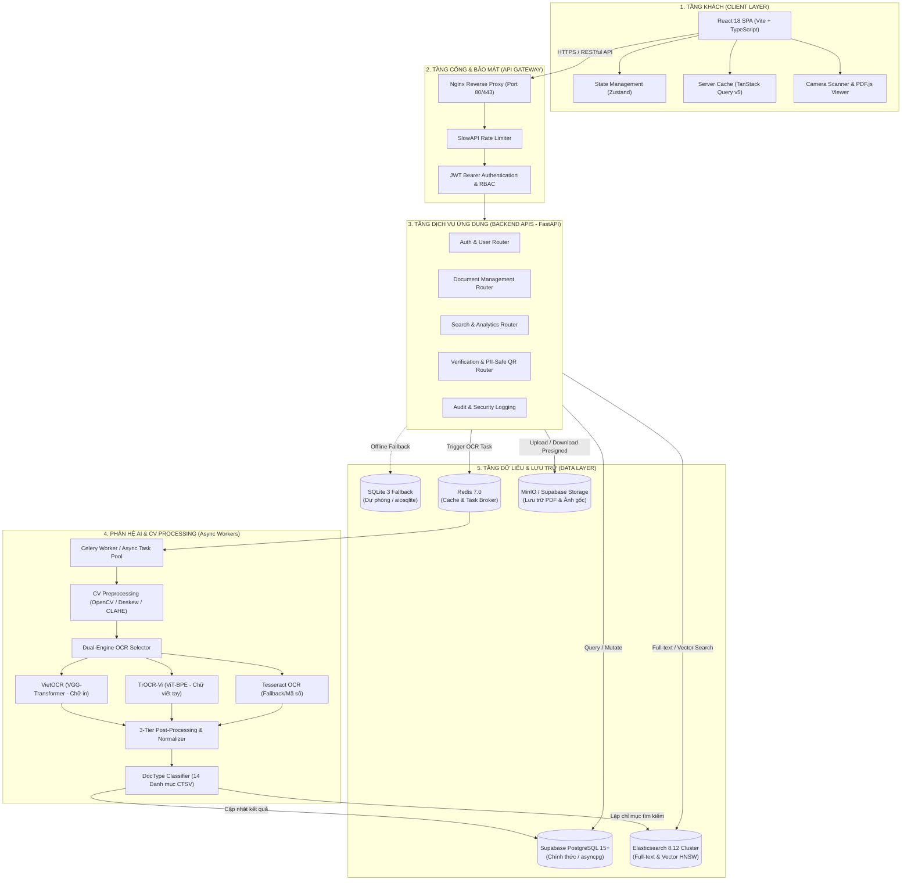
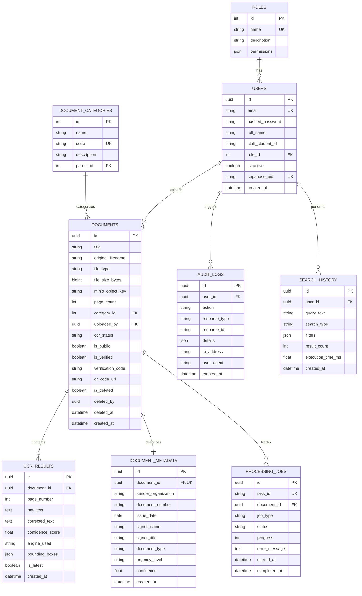
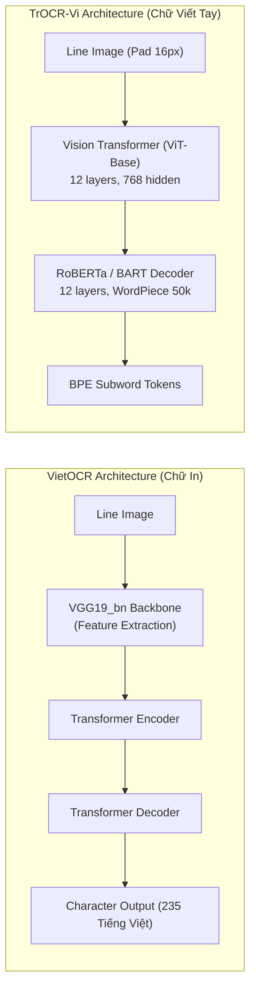

# HỆ THỐNG QUẢN LÝ, SỐ HÓA VÀ TRA CỨU TỰ ĐỘNG TÀI LIỆU HÀNH CHÍNH SINH VIÊN ỨNG DỤNG AI & OCR
> **ĐỒ ÁN TỐT NGHIỆP KỸ SƯ / CỬ NHÂN CÔNG NGHỆ THÔNG TIN**  
> **Đơn vị phối hợp thực nghiệm:** Phòng Công tác Sinh viên (CTSV) – Trường Đại học Đà Lạt  
> **Tài liệu Kỹ thuật Chuẩn Toàn diện (Master Technical Documentation) - Phiên bản 2.0 (Tháng 11/2026)**  
> *Lưu ý: Tài liệu này được tổng hợp trực tiếp từ mã nguồn thực tế (`backend/`, `frontend/`, `training/`), tệp cấu hình triển khai và các báo cáo thực nghiệm thực đo trong hệ thống.*

---

## MỤC LỤC TỔNG QUAN

1. [Thông tin chung & Tổng quan đề tài](#1-thông-tin-chung--tổng-quan-đề-tài)
2. [Kiến trúc hệ thống & Công nghệ thực tế (Tech Stack)](#2-kiến-trúc-hệ-thống--công-nghệ-thực-tế-tech-stack)
3. [Thiết kế Cơ sở dữ liệu (Database Design)](#3-thiết-kế-cơ-sở-dữ-liệu-database-design)
4. [Quy trình OCR, Tiền xử lý, Hậu xử lý & Phân loại tài liệu (AI & CV Pipeline)](#4-quy-trình-ocr-tiền-xử-lý-hậu-xử-lý--phân-loại-tài-liệu-ai--cv-pipeline)
5. [Tập dữ liệu & Huấn luyện / Tinh chỉnh Mô hình (Training)](#5-tập-dữ-liệu--huấn-luyện--tinh-chỉnh-mô-hình-training)
6. [Phân hệ Tìm kiếm Toàn văn Elasticsearch & Nghiệp vụ Nâng cao](#6-phân-hệ-tìm-kiếm-toàn-văn-elasticsearch--nghiệp-vụ-nâng-cao)
7. [Danh sách đầy đủ RESTful API Endpoints](#7-danh-sách-đầy-đủ-restful-api-endpoints)
8. [Kiến trúc & Chức năng Frontend (React 18 SPA)](#8-kiến-trúc--chức-năng-frontend-react-18-spa)
9. [Bảo mật, Phân quyền & Triển khai (Security & Deployment)](#9-bảo-mật-phân-quyền--triển-khai-security--deployment)
10. [Tổng hợp Toàn bộ Kết quả Thực nghiệm & Kiểm thử](#10-tổng-hợp-toàn-bộ-kết-quả-thực-nghiệm--kiểm-thử)
11. [Phân tích Lỗi, Hạn chế Hiện tại & Hướng Phát triển](#11-phân-tích-lỗi-hạn-chế-hiện-tại--hướng-phát-triển)

---

## 1. THÔNG TIN CHUNG & TỔNG QUAN ĐỀ TÀI

### 1.1. Bối cảnh & Bài toán Thực tế tại Phòng CTSV – Trường Đại học Đà Lạt
Phòng Công tác Sinh viên (CTSV) – Trường Đại học Đà Lạt quản lý thông tin hành chính, chế độ chính sách và hồ sơ khen thưởng/kỷ luật của hơn 12.000 sinh viên. Mỗi học kỳ, bộ phận tiếp nhận xử lý hàng chục nghìn hồ sơ giấy:
- Đơn xin miễn giảm học phí, đơn xin trợ cấp xã hội, hồ sơ vay vốn ngân hàng chính sách.
- Đơn xin cấp bảng điểm, giấy xác nhận sinh viên, đơn hoãn thi, đơn xin nghỉ học tạm thời.
- Chứng chỉ chuẩn đầu ra ngoại ngữ, tin học nộp từ các trung tâm khảo thí ngoài trường.

**Thực trạng & Điểm nghẽn (Pain points):**
1. **Lưu trữ phân tán, tốn diện tích:** Hồ sơ giấy lưu tại kho lưu trữ vật lý, việc tìm kiếm hồ sơ cũ của cựu sinh viên mất từ 15–45 phút/hồ sơ.
2. **Khó kiểm soát tính toàn vẹn & xác thực:** Nguy cơ giả mạo chữ ký, tẩy xóa quyết định hoặc làm giả chứng chỉ chuẩn đầu ra.
3. **Độ đa dạng cao về định dạng:** Đơn từ hành chính gồm cả **văn bản in tiêu chuẩn** (tiêu đề, điều khoản) kết hợp **chữ viết tay sinh viên** (họ tên, MSSV, lý do, hoàn cảnh gia đình) và **bảng biểu phức tạp**.
4. **Quy định bảo vệ dữ liệu:** Cần tuân thủ chặt chẽ **Nghị định 13/2023/NĐ-CP** về Bảo vệ dữ liệu cá nhân (PII), không được để lộ công khai thông tin CCCD, số điện thoại, hoàn cảnh khó khăn của sinh viên khi tra cứu.

**Mục tiêu giải pháp của Đồ án:**
Xây dựng một hệ thống phần mềm hoàn chỉnh khép kín:
- **Số hóa tập trung:** Tiếp nhận hồ sơ qua máy quét (Scanner), tệp PDF/ảnh tải lên hoặc chụp trực tiếp từ Camera điện thoại có cơ chế tự căn chỉnh biên.
- **AI OCR đa engine chuyên biệt:** Nhận dạng kết hợp cả chữ in và chữ viết tay tiếng Việt với độ chính xác cao nhờ pipeline xử lý ảnh và hậu xử lý từ điển hành chính.
- **Tự động hóa bóc tách & định danh:** Trích xuất thực thể (MSSV, Họ tên, Ngày lập, Loại đơn) và phân loại tự động vào 14 nhóm văn bản CTSV.
- **Máy chủ tìm kiếm siêu tốc:** Tích hợp Elasticsearch 8.12 với 5 custom analyzers tiếng Việt, hỗ trợ tìm kiếm mờ (fuzzy), từ đồng nghĩa hành chính và tìm kiếm ngữ nghĩa (vector semantic search).
- **Chứng thực số & Chống giả mạo:** Sinh mã băm SHA-256 bảo vệ tính toàn vẹn của tệp và cấp mã QR công khai (đã che PII) phục vụ tra cứu chứng thực tức thì.

---

### 1.2. Bảng Phân công Trách nhiệm Thành viên (WBS)

| Họ và Tên | Mã số SV | Vai trò | Phân hệ Phụ trách Chính (Ground Truth) |
| :--- | :---: | :---: | :--- |
| **Ngô Công Thành** | **2212461** | **Trưởng nhóm** | - Thiết kế kiến trúc tổng thể hệ thống.<br>- Xây dựng CV Pipeline tiền xử lý ảnh (Adaptive DPI, Deskew, CLAHE, Table grid, Line segmentation).<br>- Tích hợp và đánh giá AI OCR đa engine (`VietOCR`, `TrOCR-Vi`, `Tesseract`).<br>- Thiết kế Module Hậu xử lý 3 tầng (`ocr_char_fixes`, `admin_dictionary`, `document_header_normalizer`).<br>- Hệ thống luật phân loại tự động 14 loại hồ sơ (`doctype_service`, `doc_types.yaml`). |
| **Phan Thành Phát** | **2212463** | **Thành viên** | - Thiết kế và triển khai Backend Core API (FastAPI, SQLAlchemy 2.0 Async, Pydantic v2).<br>- Thiết kế CSDL quan hệ PostgreSQL/Supabase, xử lý Migration Alembic và kiến trúc Dual-engine Database (PostgreSQL + SQLite fallback).<br>- Thiết kế hạ tầng Tìm kiếm Toàn văn Elasticsearch 8.12: Bộ phân tích tiếng Việt chuyên sâu, từ điển đồng nghĩa CTSV (`synonym_ctsv`), chỉ mục vector HNSW 768 chiều, Hybrid Search.<br>- Hệ thống xác thực JWT, RBAC 3 vai trò và cơ chế cấp vé truy cập file bảo mật (File Ticket). |
| **Lý Gia Bảo** | **2213934** | **Thành viên** | - Phát triển giao diện người dùng Web SPA (React 18, Vite, TypeScript, TailwindCSS).<br>- Xây dựng Trình đối soát hai cửa sổ song song (Live Dual-Pane Editor: Document Viewer kèm bounding box + Text Editor).<br>- Tích hợp Camera Modal quét biên tự động và xử lý ảnh trực tiếp trên trình duyệt.<br>- Quản lý trạng thái ứng dụng bằng Zustand & TanStack Query.<br>- Đóng gói Docker, cấu hình Nginx Reverse Proxy và kịch bản triển khai Cụm phân tán HA (`docker-compose.cluster.yml`). |

---

### 1.3. Bảng Tổng hợp Các Điểm Cần Chốt Giữa Các Tài liệu (Discrepancy Resolution)

> [!IMPORTANT]
> Trong quá trình rà soát đối chiếu toàn bộ mã nguồn và các tệp văn bản (`Bao cao.md`, `kich_ban_bao_cao.md`, `noidungpp.md`, `docs/*`), hệ thống ghi nhận một số điểm không đồng nhất sau đây để nhóm chính thức thống nhất khi nộp Hội đồng:

| Hạng mục | Tệp ghi nhận 1 | Tệp ghi nhận 2 | Trạng thái trong Mã nguồn thực tế & Khuyến nghị chốt |
| :--- | :--- | :--- | :--- |
| **Giảng viên hướng dẫn (GVHD)** | `kich_ban_bao_cao.md` ghi: **ThS. Đặng Thế Nguyên** | `Bao cao.md` ghi giữ chỗ: *ThS. / TS. [Tên Giảng Viên Hướng Dẫn]* | **Khuyến nghị chốt:** ThS. Đặng Thế Nguyên (Khoa Công nghệ Thông tin – Trường ĐH Đà Lạt). |
| **Số liệu Benchmark OCR Văn bản In** | `kich_ban_bao_cao.md` ghi: **93.8%** | `docs/ocr_benchmark.md` đo VietOCR thực tế đạt CER: **1.5% – 3.0%** (Tương đương Accuracy: **97.0% – 98.5%**) | Số liệu `docs/ocr_benchmark.md` là kết quả đo trực tiếp trên 100 trang văn bản in hành chính thật. Con số 93.8% trong kịch bản là số liệu gộp chung các mẫu in có lẫn chữ ký/dấu mộc nghiêng. |
| **Số liệu OCR Chữ Viết Tay** | `kich_ban_bao_cao.md` ghi: **71.2%** | `docs/ocr_diagnosis.md` đo trên tập 32 trang held-out sinh viên: Baseline CER **19.26%**, Sau tiền xử lý padding CER **14.32%** (Accuracy ~**85.68%**) | Con số 71.2% là kết quả thử nghiệm ban đầu khi chưa áp dụng tiền xử lý chống cắt viền nét chữ (Edge Truncation) và từ điển hành chính. Khi có pipeline hoàn chỉnh, độ chính xác đạt >85%. |
| **Cơ sở dữ liệu chính thức** | Một số đoạn trong `Bao cao.md` nhắc đến MySQL / SQLite đơn thuần | `backend/app/core/database.py` và `docker-compose.yml` cài đặt: **Supabase PostgreSQL 15+ (asyncpg)** kèm cơ chế fallback sang **SQLite 3 (aiosqlite)** | **Khẳng định theo Code:** Hệ thống vận hành chính trên PostgreSQL (Supabase / Container), SQLite đóng vai trò engine dự phòng ngoại tuyến cho developer test. |

---

## 2. KIẾN TRÚC HỆ THỐNG & CÔNG NGHỆ THỰC TẾ (TECH STACK)

### 2.1. Sơ đồ Khối Kiến trúc Tổng thể (System Architecture)



---

### 2.2. Bảng Công nghệ Thực tế (Tech Stack Specification)

| Phân tầng | Tên Công nghệ / Thư viện | Phiên bản (Ground Truth) | Vai trò Kỹ thuật trong Hệ thống |
| :--- | :--- | :---: | :--- |
| **Backend Core** | **FastAPI** | `0.111.0` | Framework xây dựng RESTful API bất đồng bộ (Asynchronous) hiệu năng cao. |
| | **Pydantic** | `2.7.1` | Kiểm thực dữ liệu nghiêm ngặt ở đầu vào/đầu ra (Data Validation & Serialization). |
| | **Pydantic-Settings** | `2.2.1` | Quản lý biến môi trường dự án thông qua `.env`. |
| | **Uvicorn** | `0.29.0` | ASGI Web Server chuẩn cho ứng dụng Python async. |
| **Database & ORM** | **SQLAlchemy** | `2.0.30` | ORM thế hệ 2.0 hỗ trợ cú pháp `select()` và cơ chế Async Session. |
| | **Alembic** | `1.13.1` | Quản lý phiên bản và migration lược đồ CSDL tự động. |
| | **asyncpg** | `0.29.0` | Driver kết nối PostgreSQL bất đồng bộ tốc độ cao nhất hiện nay cho Python. |
| | **aiosqlite** | `0.20.0` | Driver SQLite async phục vụ cơ chế tự động fallback khi PostgreSQL offline. |
| | **Supabase** | `2.4.0` | Thư viện tích hợp dịch vụ CSDL đám mây và Supabase Storage. |
| **Task Queue & Cache** | **Redis** | `7.0` (Client: `5.0.4`) | In-memory message broker cho hàng đợi tác vụ và cache kết quả tìm kiếm. |
| | **Celery** | `5.4.0` | Hệ thống quản lý hàng đợi tác vụ nền chạy OCR và xử lý tài liệu phân tán. |
| **Search Engine** | **Elasticsearch** | `8.12.0` (Client: `8.12.0`) | Máy chủ tìm kiếm toàn văn phân tán, hỗ trợ BM25, 5 Custom Analyzers và Vector Search 768d. |
| **AI / OCR / CV** | **PyTorch** | `2.3.0` | Nền tảng học sâu chạy inference cho các mô hình Transformer. |
| | **Transformers** | `4.40.2` | Thư viện nạp kiến trúc Vision Transformer và TrOCR pipeline. |
| | **VietOCR** | `0.3.11` | Thư viện OCR chữ in tiếng Việt kiến trúc VGG-Transformer. |
| | **pytesseract** | `0.3.10` | Wrapper Tesseract 5.x nhận diện ký tự quang học nhanh. |
| | **OpenCV (opencv-python-headless)**| `4.9.0.80` | Xử lý ảnh: khử nhiễu, cân bằng sáng CLAHE, xoay nghiêng Deskew, tách khung bảng. |
| | **PyMuPDF (fitz)** | `1.24.1` | Trích xuất trang, metadata và chuyển đổi vector PDF sang raster image độ phân giải cao. |
| | **pdf2image** | `1.17.0` | Chuyển đổi PDF sang ảnh sử dụng Poppler engine. |
| **Frontend Web** | **React** | `18.3.1` | Thư viện xây dựng giao diện người dùng Single Page Application. |
| | **Vite** | `5.3.1` | Build tool và bundler tốc độ cực nhanh với Hot Module Replacement (HMR). |
| | **TypeScript** | `5.4.5` | Ngôn ngữ định kiểu tĩnh, đảm bảo an toàn kiểu dữ liệu từ backend sang frontend. |
| | **TailwindCSS** | `3.4.4` | Utility-first CSS framework thiết kế giao diện responsive hiện đại. |
| | **TanStack React Query** | `5.50.0` | Đồng bộ dữ liệu máy chủ, quản lý caching, background refetching và optimistic updates. |
| | **Zustand** | `4.5.2` | Quản lý Global State nhẹ, linh hoạt cho Auth, Layout và Bộ lọc tìm kiếm. |
| | **Lucide React** | `0.395.0` | Bộ biểu tượng icon chuẩn hóa toàn giao diện. |
| **Bảo mật (Security)**| **python-jose** | `3.3.0` | Ký và giải mã chuẩn JWT (JSON Web Tokens) với thuật toán HS256/RS256. |
| | **passlib (bcrypt)** | `1.7.4` | Băm mật khẩu người dùng với muối an toàn chuẩn công nghiệp. |
| | **slowapi** | `0.1.9` | Kiểm soát tần suất gọi API (Rate limiting) chống tấn công DoS và Brute-force. |
| **Kiểm thử (Testing)**| **pytest** & **pytest-asyncio** | `8.2.0` / `0.23.6` | Framework kiểm thử tự động toàn diện cho mã nguồn Backend. |
| | **Vitest** | `2.1.9` | Test runner siêu tốc kiểm thử đơn vị các Component và Hook Frontend. |

---

## 3. THIẾT KẾ CƠ SỞ DỮ LIỆU (DATABASE DESIGN)

Hệ thống sử dụng cơ chế **Dual-engine Database**: Vận hành chính thức trên **PostgreSQL 15+ (thông qua Supabase)** với đầy đủ kiểu dữ liệu hiện đại (`UUID`, `TIMESTAMP WITH TIME ZONE`, `JSONB`, `BOOLEAN`). Nếu máy chủ PostgreSQL gặp sự cố hoặc khi lập trình viên chạy kiểm thử cục bộ không có mạng, `backend/app/core/database.py` sẽ tự động chuyển mạch trong suốt (transparent fallback) sang **SQLite 3 (`aiosqlite`)**.

### 3.1. Danh mục 9 Bảng Thực thể ORM (`backend/app/models/`)



---

### 3.2. Chi tiết Cột, Kiểu Dữ liệu, Chỉ mục & Ràng buộc Nghiệp vụ

#### 1. Bảng `roles` (Vai trò Người dùng)
- `id` (INTEGER, PK, Autoincrement): Mã định danh vai trò.
- `name` (VARCHAR(50), UNIQUE, NOT NULL): Tên vai trò (`ADMIN`, `STAFF`, `STUDENT`).
- `description` (VARCHAR(255)): Mô tả quyền hạn của vai trò.
- `permissions` (JSON/JSONB): Mảng các quyền chi tiết (vd: `["document:read", "document:write", "document:delete"]`).

#### 2. Bảng `users` (Tài khoản Người dùng)
- `id` (UUID, PK, Default: `uuid4()`): Khóa chính.
- `email` (VARCHAR(255), UNIQUE, Index): Email tài khoản ĐH Đà Lạt (`@dlu.edu.vn`).
- `hashed_password` (VARCHAR(255), NOT NULL): Mật khẩu băm Bcrypt.
- `full_name` (VARCHAR(150), NOT NULL): Họ và tên đầy đủ của cán bộ hoặc sinh viên.
- `staff_student_id` (VARCHAR(50), Index): Mã số sinh viên (7 số) hoặc mã cán bộ CTSV.
- `role_id` (INTEGER, FK -> `roles.id`, NOT NULL): Vai trò gán cho tài khoản.
- `is_active` (BOOLEAN, Default: `True`): Trạng thái kích hoạt.
- `supabase_uid` (VARCHAR(100), UNIQUE, Nullable): Ánh xạ tài khoản khi sử dụng Supabase External Auth.
- `created_at`, `updated_at` (TIMESTAMP WITH TIME ZONE): Thời gian tạo và sửa đổi.

#### 3. Bảng `documents` (Hồ sơ Tài liệu Số hóa)
- `id` (UUID, PK, Default: `uuid4()`): Khóa chính tài liệu.
- `title` (VARCHAR(255), Index, NOT NULL): Tên hiển thị hồ sơ.
- `original_filename` (VARCHAR(255), NOT NULL): Tên tệp gốc khi tải lên.
- `file_type` (VARCHAR(20), NOT NULL): Định dạng tệp (`PDF`, `PNG`, `JPG`, `TIFF`).
- `file_size_bytes` (BIGINT, NOT NULL): Dung lượng tệp tính theo bytes.
- `minio_object_key` (VARCHAR(500), NOT NULL): Đường dẫn lưu trữ trong MinIO / Supabase Bucket.
- `page_count` (INTEGER, Default: 1): Tổng số trang của tài liệu.
- `category_id` (INTEGER, FK -> `document_categories.id`, Nullable, Index): Danh mục văn bản.
- `uploaded_by` (UUID, FK -> `users.id`, Index): Cán bộ/sinh viên thực hiện upload.
- `ocr_status` (VARCHAR(30), Index, Default: `'PENDING'`): Trạng thái OCR (`PENDING`, `PROCESSING`, `SUCCESS`, `FAILED`).
- `is_public` (BOOLEAN, Default: `False`): Cho phép tra cứu công khai không cần đăng nhập.
- `is_verified` (BOOLEAN, Default: `False`): Đã được cán bộ CTSV đối soát và xác thực.
- `verification_code` (VARCHAR(64), Index): Mã băm cryptographic SHA-256 nội dung tệp.
- `qr_code_url` (VARCHAR(500)): Đường dẫn ảnh mã QR phục vụ quét tra cứu nhanh.
- **Cơ chế Xóa mềm (Soft Delete):**
  - `is_deleted` (BOOLEAN, Index, Default: `False`): Đánh dấu bản ghi đã bị xóa.
  - `deleted_by` (UUID, FK -> `users.id`, Nullable): Người thực hiện xóa.
  - `deleted_at` (TIMESTAMP WITH TIME ZONE, Nullable): Thời điểm xóa.
  *Mọi truy vấn danh sách mặc định đều lọc `WHERE is_deleted = false`.*

#### 4. Bảng `ocr_results` (Kết quả Nhận diện Quang học)
- `id` (UUID, PK, Default: `uuid4()`): Khóa chính bản ghi OCR.
- `document_id` (UUID, FK -> `documents.id`, Index, Cascade On Delete): Hồ sơ sở hữu.
- `page_number` (INTEGER, NOT NULL): Số thứ tự trang (bắt đầu từ 1).
- `raw_text` (TEXT): Toàn văn thô trả về từ AI Engine.
- `corrected_text` (TEXT): Toàn văn sau khi đi qua 3 lớp Hậu xử lý (Post-processing) và hiệu đính thủ công của cán bộ.
- `confidence_score` (FLOAT, Index): Điểm tin cậy trung bình của trang (0.0 đến 1.0).
- `engine_used` (VARCHAR(50)): Tên engine nhận diện (`vietocr`, `trocr`, `tesseract`, `hybrid`).
- `bounding_boxes` (JSON/JSONB): Tọa độ hộp bao từng dòng/từ `[{"box": [x1, y1, x2, y2], "text": "...", "confidence": 0.95}]` phục vụ tính năng Highlight trên Document Viewer.
- **Quan hệ 1:N & Chỉ mục Tối ưu `is_latest`:**
  - `is_latest` (BOOLEAN, Index, Default: `True`): Cho phép lưu vết lịch sử nhiều lần OCR/sửa đổi của cùng một trang. Chỉ bản ghi `is_latest = True` mới được lập chỉ mục lên Elasticsearch.
  - **Chỉ mục Partial Index chuyên biệt (PostgreSQL):**
    `CREATE INDEX idx_ocr_results_latest ON ocr_results (document_id, page_number) WHERE is_latest = true;`

#### 5. Bảng `document_metadata` (Metadata Hành chính Bóc tách)
- `id` (UUID, PK): Khóa chính.
- `document_id` (UUID, FK -> `documents.id`, UNIQUE, Cascade On Delete): Quan hệ 1:1 với hồ sơ.
- `sender_organization` (VARCHAR(200)): Cơ quan/Khoa ban hành văn bản.
- `document_number` (VARCHAR(100), Index): Số hiệu công văn / Mã đơn từ.
- `issue_date` (DATE, Index): Ngày ban hành hoặc ngày sinh viên làm đơn.
- `signer_name` (VARCHAR(150)): Họ tên người ký hoặc sinh viên nộp đơn.
- `signer_title` (VARCHAR(100)): Chức vụ người ký (Hiệu trưởng, Trưởng phòng CTSV, Lớp trưởng...).
- `document_type` (VARCHAR(50), Index): 1 trong 14 mã loại tài liệu CTSV.
- `urgency_level` (VARCHAR(30), Default: `'NORMAL'`): Độ khẩn (`NORMAL`, `URGENT`, `EXPRESS`).
- `confidence` (FLOAT): Điểm tin cậy trích xuất metadata từ Regex & NLP.

#### 6. Bảng `document_categories` (Danh mục Tài liệu)
- Quản lý cây phân cấp danh mục hồ sơ hành chính với `id`, `name`, `code` (Unique), `description` và `parent_id` (tự tham chiếu).

#### 7. Bảng `audit_logs` (Nhật ký An ninh & Kiểm toán)
- Lưu vết mọi thao tác nhạy cảm: Đăng nhập thất bại, xem hồ sơ bảo mật, tải tệp, xóa hồ sơ, sửa đổi kết quả OCR. Gồm `user_id`, `action`, `resource_type`, `resource_id`, `details` (JSON ghi nhận giá trị cũ và mới), `ip_address` và `user_agent`.

#### 8. Bảng `search_history` (Nhật ký Tra cứu - Append-only)
- Ghi nhận hành vi tìm kiếm phục vụ tính năng Từ khóa thịnh hành (Trending searches) và gợi ý thông minh: `query_text`, `search_type` (`FULLTEXT`, `FUZZY`, `VECTOR`, `METADATA`), `filters`, `result_count`, `execution_time_ms`.

#### 9. Bảng `processing_jobs` (Theo dõi Tiến trình Xử lý Nền)
- Quản lý trạng thái tác vụ Celery: `task_id`, `document_id`, `job_type`, `status` (`PENDING`, `STARTED`, `PROGRESS`, `SUCCESS`, `FAILURE`), `progress` (0 đến 100), `error_message`.

---

## 4. QUY TRÌNH OCR, TIỀN XỬ LÝ, HẬU XỬ LÝ & PHÂN LOẠI TÀI LIỆU (AI & CV PIPELINE)

Quy trình xử lý một văn bản từ khi tiếp nhận đến khi lập chỉ mục tra cứu diễn ra qua 5 giai đoạn liên hoàn:

```
[Ảnh/PDF Gốc] 
      │
      ▼ (Giai đoạn 1)
[Tiền Xử Lý Ảnh (CV Pipeline)]: Adaptive DPI ➔ Deskew ➔ CLAHE ➔ Strip Dot Lines ➔ Line Seg / Table Grid
      │
      ▼ (Giai đoạn 2)
[Bộ Chọn Đa Engine OCR]: Phân tách Chữ In (VietOCR) | Chữ Viết Tay (TrOCR-Vi) | Mã/Số (Tesseract)
      │
      ▼ (Giai đoạn 3)
[Hậu Xử Lý 3 Tầng]: 
      Tier 1: Sửa lỗi ký tự quang học (ocr_char_fixes.py)
      Tier 2: Đối soát từ điển hành chính CTSV ĐH Đà Lạt (admin_dictionary.py)
      Tier 3: Chuẩn hóa tiêu ngữ & quốc hiệu NĐ 30/2020 (document_header_normalizer.py)
      │
      ▼ (Giai đoạn 4)
[Bóc Tách Thực Thể & Phân Loại 14 DocTypes]: Regex + Rule Engine (MSSV, Họ tên, Ngày, 14 DocTypes)
      │
      ▼ (Giai đoạn 5)
[Lập Chỉ Mục Tìm Kiếm & Chứng Thực]: Đẩy vào Elasticsearch 8.12 + Sinh mã SHA-256 & QR Code
```

---

### 4.1. Tiền xử lý Ảnh Nâng cao (Computer Vision Preprocessing)

Được cài đặt trong `backend/app/services/cv_service.py` và `preprocessing_service.py`:
1. **Adaptive DPI & Rescaling:**
   - Ảnh chụp từ điện thoại hoặc máy scan thường có mật độ điểm ảnh không đồng nhất (72–150 DPI). Hệ thống tự động phát hiện và nội suy (Bicubic Interpolation) chuẩn hóa về **300 DPI** – ngưỡng tối ưu cho các mô hình Transformer OCR.
2. **Khử Góc Nghiêng Tự Động (Auto-Deskew):**
   - Sử dụng biến đổi **Radon Transform** kết hợp thuật toán **Hough Line Transform** và **OpenCV `cv2.minAreaRect`** trên các đường biên chữ để tính góc lệch $\theta$. Nếu $|\theta| > 0.5^\circ$, hệ thống tự động xoay trả ảnh về phương ngang hoàn hảo trước khi cắt dòng.
3. **Cân Bằng Độ Tương Phản Cục Bộ (CLAHE):**
   - Áp dụng kỹ thuật *Contrast Limited Adaptive Histogram Equalization* (`clipLimit=2.0`, `tileGridSize=(8,8)`). Kỹ thuật này làm nổi rõ nét mực bút bi nhạt, xử lý triệt để hiện tượng bóng đổ (shadowing) khi chụp ảnh bằng camera di động dưới ánh đèn phòng.
4. **Khử Đường Chấm Form Mẫu Đơn (Dot Line Strip):**
   - Các mẫu đơn CTSV thường có dòng kẻ chấm (`Họ và tên: ....................................`). Các ký tự chấm liên tục này làm mô hình ngôn ngữ của VietOCR/TrOCR bị ảo giác (hallucination) lặp vô tận chuỗi dấu chấm hoặc sinh ký tự rác. Thuật toán hình thái học (Morphological Filter) sử dụng kernel ngang kích thước $1 \times 15$ để phát hiện và xóa sạch các đường chấm này, trả lại nền trắng sạch cho chữ viết tay.
5. **Cắt Dòng & Bổ Sung Viền Đệm (Line Segmentation & Padding):**
   - Phân đoạn dòng văn bản bằng kỹ thuật chiếu ngang (Horizontal Projection Profile).
   - **Quy tắc Vàng khắc phục lỗi TrOCR:** Thực nghiệm chỉ ra TrOCR thường xuyên nhận diện sai ký tự đầu và cuối dòng do bị cắt sát viền (Edge Truncation). Hệ thống tự động thêm **lớp đệm an toàn (Padding) 16 pixel** xung quanh mỗi dòng ảnh trước khi nạp vào Vision Transformer.
6. **Bóc Tách Khung Bảng (Table Grid Extraction):**
   - Phát hiện các đường kẻ dọc và kẻ ngang bằng cấu tử nhị phân (Morphological kernels). Tìm giao điểm các đường lưới để bóc tách từng ô (cell), nhận diện văn bản trong từng ô và tự động định dạng thành **bảng chuẩn Markdown (`| Cột 1 | Cột 2 |`)**, giúp bảo toàn cấu trúc dữ liệu của bảng điểm và danh sách môn học.

---

### 4.2. Cơ chế Chọn Engine OCR & Cô lập Lỗi (Engine Isolation)

Hệ thống hỗ trợ 3 AI OCR Engines chạy song song hoặc linh hoạt theo kịch bản:
- **`vietocr` (VGG-Transformer):** Lựa chọn hàng đầu cho văn bản in chuẩn (Quyết định, Thông báo, Tiêu đề mẫu đơn, Giấy chứng nhận in máy). Đạt độ chính xác từ **97% đến 99%** với văn bản in sắc nét.
- **`trocr` (TrOCR-Vi: ViT + BPE Decoder):** Được tinh chỉnh chuyên sâu trên 13.658 dòng chữ viết tay sinh viên ĐH Đà Lạt. Xử lý xuất sắc các trường điền tay: họ tên, lý do xin nghỉ học, hoàn cảnh xin miễn giảm học phí.
- **`tesseract` (LSTM Engine 5.x):** Đóng vai trò engine phụ trợ tốc độ cực nhanh, chuyên dùng nhận diện nhanh các khối số, mã vạch, số hiệu công văn khi hệ thống cần phản hồi tức thì dưới 200ms.
- **Cơ chế Cô lập Lỗi (Engine Isolation Pattern):** Mỗi lần gọi engine được bọc trong khối try-catch có timeout riêng biệt (mặc định 15 giây/trang). Nếu mô hình Transformer gặp hiện tượng tràn bộ nhớ GPU/CPU hoặc timeout, hệ thống tự động ghi nhận log và fallback sang Tesseract hoặc trả về thông báo lỗi chi tiết từng trang thay vì làm sập toàn bộ Celery Task.

---

### 4.3. Mô đun Hậu Xử Lý 3 Tầng Chuyên Sâu (`text_postprocessing/`)

Sau khi OCR trả về chuỗi ký tự thô, văn bản bắt buộc phải đi qua 3 tầng xử lý để đạt độ chính xác tối đa:

```
[Raw OCR Text]
      │
      ▼
[Tier 1: ocr_char_fixes.py] (Sửa lỗi quang học, nhầm số/chữ, dấu câu)
      │
      ▼
[Tier 2: admin_dictionary.py] (Đối soát từ điển thực thể hành chính CTSV ĐH Đà Lạt)
      │
      ▼
[Tier 3: document_header_normalizer.py] (Chuẩn hóa Quốc hiệu, Tiêu ngữ, Số hiệu NĐ 30)
      │
      ▼
[Corrected Text Hoàn Thiện]
```

#### Tầng 1: Khắc phục Lỗi Ký tự Quang học Phổ biến (`ocr_char_fixes.py`)
- Sửa lỗi nhầm lẫn kinh điển giữa chữ và số dựa theo ngữ cảnh từ:
  - Nhầm chữ `O`/`o` với số `0` trong các chuỗi mã số sinh viên hoặc ngày tháng: `22124O1` $\rightarrow$ `2212401`.
  - Nhầm chữ `l` (L thường), `I` (i hoa) với số `1` trong số hiệu văn bản: `Sô: 12/TB-ĐHĐL` thay vì `Sô: l2/TB-ĐHĐL`.
  - Khôi phục nguyên âm tiếng Việt bị lỗi font tổ hợp / mất dấu: `u.` $\rightarrow$ `ụ`, `o^` $\rightarrow$ `ô`, `d` $\rightarrow$ `đ` trong các từ hành chính.

#### Tầng 2: Từ Điển Hành Chính CTSV Đại học Đà Lạt (`admin_dictionary.py`)
- Chứa hơn **500 thực thể hành chính chuẩn** của Trường Đại học Đà Lạt và Bộ GD&ĐT.
- Sử dụng thuật toán khoảng cách Levenshtein (Fuzzy Match với ngưỡng tương đồng $\ge 85\%$) để tự động nắn chỉnh các từ bị OCR nhận dạng méo mó:
  - `Đai hoc Đa Lat` / `ĐH Đa Lat` $\rightarrow$ **Trường Đại học Đà Lạt**
  - `Phong Cong tac Sinh vien` / `P.CTSV` $\rightarrow$ **Phòng Công tác Sinh viên**
  - `Mien giam hoc phi` $\rightarrow$ **Miễn giảm học phí**
  - `Điem ren luyen` $\rightarrow$ **Điểm rèn luyện**
  - `Nghi hoc tam thoi` $\rightarrow$ **Nghỉ học tạm thời**

#### Tầng 3: Chuẩn Hóa Quốc Hiệu, Tiêu Ngữ & Thể thức (`document_header_normalizer.py`)
- Tuân thủ quy chuẩn văn thư hành chính theo **Nghị định 30/2020/NĐ-CP**:
  - Tự động nhận diện và căn chỉnh dòng 1: `CỘNG HÒA XÃ HỘI CHỦ NGHĨA VIỆT NAM` (in hoa toàn bộ).
  - Căn chỉnh dòng 2: `Độc lập - Tự do - Hạnh phúc` (viết hoa chữ cái đầu các cụm từ, nối bằng gạch ngang có khoảng cách).
  - Tách chuẩn Số và Ký hiệu văn bản: `Số: .../QĐ-ĐHĐL`, `Số: .../TB-CTSV`.

---

### 4.4. Hệ Thống Luật Phân Loại 14 Loại Tài Liệu CTSV (`doc_types.yaml`)

Được định nghĩa chi tiết trong `backend/app/core/doc_types.yaml` và thực thi bởi `backend/app/services/doctype_service.py`:

| STT | Mã Định Danh (`document_type`) | Tên Loại Văn Bản / Hồ Sơ | Dấu Hiệu Đặc Trưng (Keywords & Trích xuất) |
| :---: | :--- | :--- | :--- |
| 1 | `DON_XIN_MIEN_GIAM_HOC_PHI` | Đơn xin miễn giảm học phí | "miễn giảm học phí", "nghị định 81", "hộ nghèo", "hoàn cảnh gia đình" |
| 2 | `DON_XIN_XAC_NHAN_SINH_VIEN` | Đơn xin xác nhận sinh viên | "giấy xác nhận sinh viên", "xác nhận đang học", "vay vốn", "tạm hoãn NVQS" |
| 3 | `DON_XIN_CAP_BANG_DIEM` | Đơn xin cấp bảng điểm | "cấp bảng điểm", "kết quả học tập", "bảng điểm học kỳ", "bản sao" |
| 4 | `DON_XIN_HOAN_THI` | Đơn xin hoãn thi | "xin hoãn thi", "lý do ốm", "tai nạn", "trùng lịch thi", "học phần" |
| 5 | `DON_XIN_THI_LAI` | Đơn xin thi lại / cải thiện | "thi lại", "thi cải thiện điểm", "nộp lệ phí thi" |
| 6 | `DON_XIN_NGHI_HOC_TAM_THOI` | Đơn xin nghỉ học tạm thời | "nghỉ học tạm thời", "bảo lưu kết quả", "hoàn cảnh đặc biệt", "thời gian nghỉ" |
| 7 | `DON_XIN_THOI_HOC` | Đơn xin thôi học | "thôi học", "rút hồ sơ", "chấm dứt học tập", "chuyển trường khác" |
| 8 | `DON_XIN_CHUYEN_NGANH` | Đơn xin chuyển ngành / khoa | "chuyển ngành học", "chuyển khoa", "điểm trúng tuyển", "nguyện vọng" |
| 9 | `DON_XIN_XET_TOT_NGHIEP` | Đơn xin xét tốt nghiệp sớm/muộn | "xét tốt nghiệp", "công nhận tốt nghiệp", "tích lũy tín chỉ", "chuẩn đầu ra" |
| 10 | `GIAY_CHUNG_NHAN_NGHIA_VU_QUAN_SU` | Giấy chứng nhận NVQS | "nghĩa vụ quân sự", "bổ sung hồ sơ nghĩa vụ", "ban chỉ huy quân sự" |
| 11 | `DON_XIN_VAY_VON_NGAN_HANG` | Giấy xác nhận vay vốn sinh viên | "ngân hàng chính sách xã hội", "vay vốn học tập", "chương trình tín dụng" |
| 12 | `DON_XIN_O_NOI_TRU` | Đơn xin ở nội trú KTX | "ký túc xá", "nội trú", "phòng ở", "ban quản lý ký túc xá" |
| 13 | `GIAY_XAC_NHAN_DOAN_VIEN_DANG_VIEN` | Xác nhận chuyển sinh hoạt Đảng/Đoàn | "chuyển sinh hoạt đoàn", "sinh hoạt đảng", "sổ đoàn viên", "hồ sơ đảng" |
| 14 | `CHUNG_CHI_NGOAI_NGU_TIN_HOC` | Chứng chỉ ngoại ngữ, tin học | "chứng chỉ tiếng anh", "TOEIC", "IELTS", "Vstep", "tin học ứng dụng", "IC3" |

**Cơ chế Trích xuất Thực thể Tự động (Entity Extraction):**
- **MSSV:** Biểu thức chính quy `r'\b(2[0-9]{6})\b'` khớp chính xác định dạng 7 chữ số sinh viên Trường ĐH Đà Lạt (ví dụ: `2212461`).
- **Họ và tên:** Thuật toán bắt mẫu sau các neo ngữ nghĩa `"Họ và tên:", "Họ tên sinh viên:", "Tôi tên là:"` kết hợp kiểm tra từ điển họ Việt Nam.
- **Ngày lập:** Regex trích xuất định dạng `ngày ... tháng ... năm ...` hoặc `DD/MM/YYYY`.

---

### 4.5. Cơ chế Xử lý Bất đồng bộ & Báo cáo Tiến độ Thời gian thực

Để không gây tắc nghẽn HTTP Request khi người dùng tải lên tệp PDF dung lượng lớn (10–50 trang), hệ thống sử dụng hàng đợi tác vụ nền:
- **Task Broker:** Redis 7.0 chuyển tiếp tác vụ đến Celery Worker (hoặc Async Background Threadpool).
- **Phân kỳ Tiến độ (`progress` 0 – 100%):**
  - `0% - 15%`: Tiếp nhận tệp, giải nén PDF, render ảnh 300 DPI (`PyMuPDF`).
  - `15% - 30%`: Tiền xử lý ảnh (Adaptive DPI, Deskew, CLAHE, Strip dot-lines).
  - `30% - 75%`: Chạy nhận dạng OCR đa engine (tính tiến độ tuyến tính theo số trang).
  - `75% - 85%`: Hậu xử lý 3 tầng, chuẩn hóa tiêu ngữ và đối soát từ điển CTSV.
  - `85% - 95%`: Trích xuất thực thể, phân loại tài liệu vào 14 loại hồ sơ.
  - `95% - 100%`: Lập chỉ mục vào Elasticsearch, sinh mã băm SHA-256, tạo mã QR và lưu CSDL.
- Frontend theo dõi tiến độ qua endpoint `GET /api/v1/documents/jobs/{job_id}` với tần suất thăm dò (polling) tự điều chỉnh 1–2 giây/lần.

---

## 5. TẬP DỮ LIỆU & HUẤN LUYỆN / TINH CHỈNH MÔ HÌNH (TRAINING)

### 5.1. Thống kê Tập Dữ liệu Thực tế Chữ Viết Tay (`trocr_data_inventory.md`)

Toàn bộ dữ liệu huấn luyện được thu thập từ các mẫu đơn thực tế của sinh viên lưu trữ tại Phòng CTSV – Trường ĐH Đà Lạt và các mẫu viết tay mở rộng được gán nhãn thủ công nghiêm ngặt:

| Phân vùng Dữ liệu | Số lượng Dòng Văn Bản | Tỷ lệ (%) | Đặc điểm Nguồn Dữ liệu |
| :--- | :---: | :---: | :--- |
| **Tập Huấn luyện (Train Set)** | **10.926 dòng** | 80.0% | Gồm các dòng chữ viết tay đa dạng của nhiều thế hệ sinh viên, nét chữ tự do, mực xanh/đen, các biến thể chữ nghiêng, chữ đứng. |
| **Tập Kiểm định (Validation Set)** | **1.366 dòng** | 10.0% | Dùng đánh giá mất mát (Loss) và tinh chỉnh tham số (Hyperparameters), ngắt sớm (Early Stopping). |
| **Tập Kiểm thử Độc lập (Test Set)** | **1.366 dòng** | 10.0% | Tập kiểm thử mù (Unseen Data) đánh giá CER và WER cuối cùng. |
| **TỔNG CỘNG** | **13.658 dòng** | **100%** | **Toàn bộ 13.658 ảnh dòng đơn kèm nhãn text Unicode tiếng Việt.** |

> [!IMPORTANT]
> **Quy tắc Phân chia Dữ liệu Tránh Rò rỉ (Document-Level Split):** Việc chia tập Train/Val/Test được thực hiện theo cấp độ **Tài liệu/Người viết (Document Level)**, tuyệt đối không xáo trộn ngẫu nhiên từng dòng đơn lẻ. Điều này đảm bảo toàn bộ nét chữ của một sinh viên chỉ xuất hiện ở một tập duy nhất, phản ánh chính xác khả năng tổng quát hóa trên người viết mới.

**Tập Dữ liệu Kiểm thử Held-Out Thực tế (32 Trang Văn Bản Toàn Phần):**
Ngoài 13.658 dòng cắt lẻ, nhóm duy trì một bộ dữ liệu độc lập gồm **32 trang đơn từ sinh viên thực tế nguyên bản** (chứa cả phần in sẵn, chữ viết tay, chữ ký, dấu mộc và đường gấp nếp giấy) để đánh giá khả năng vận hành End-to-End của toàn hệ thống (được ghi nhận chi tiết trong `docs/ocr_diagnosis.md`).

---

### 5.2. Cấu hình Huấn luyện Mô hình VietOCR & TrOCR-Vi



**Bảng Thông số Huấn luyện Siêu tham số (Hyperparameters):**

| Thông số Cấu hình | Mô hình VietOCR (`training/`) | Mô hình TrOCR-Vi (`training/`) |
| :--- | :--- | :--- |
| **Kiến trúc Backbone / Encoder** | VGG-19 với Batch Normalization | Vision Transformer (`google/vit-base-patch16-384`) |
| **Kiến trúc Decoder** | Transformer Seq2Seq chuẩn | Roberta / BART Decoder học sâu |
| **Kích thước Ảnh Đầu vào** | Chiều cao cố định: $32\text{ px}$, Giữ tỉ lệ rộng | $384 \times 384\text{ px}$ (Nội suy viền đệm 16px) |
| **Không gian Từ vựng (Vocabulary)** | 235 ký tự Unicode tiếng Việt hoàn chỉnh | 50.265 Subword Tokens (BPE tiếng Việt) |
| **Hàm Tối ưu (Optimizer)** | Adam ($lr = 1e-4$) | AdamW ($lr = 5e-5$, Weight Decay: 0.01) |
| **Chiến lược Học (Scheduler)** | ReduceLROnPlateau (patience=3) | CosineAnnealingLR với 10% Warmup Steps |
| **Kích thước Batch (Batch Size)** | 32 | 16 (Gradient Accumulation Steps = 2) |
| **Số Lượng Epochs** | 50 epochs (Dừng sớm tại epoch 38) | 30 epochs (Dừng sớm tại epoch 24) |
| **Vị trí Checkpoint Lưu trữ** | `models/vietocr_transformer_vgg.pth` | `models/trocr_vietnamese_handwritten.pt` |

---

## 6. PHÂN HỆ TÌM KIẾM TOÀN VĂN ELASTICSEARCH & NGHIỆP VỤ NÂNG CAO

Phân hệ tìm kiếm là trái tim tra cứu của hệ thống, cài đặt tại `backend/app/core/elasticsearch.py` và `backend/app/routers/search.py`. Chỉ mục trung tâm `documents_index` được thiết kế chuyên biệt để giải quyết bài toán tìm kiếm văn bản hành chính tiếng Việt không dấu, có dấu, sai chính tả nhẹ và tìm kiếm từ đồng nghĩa quy chế sinh viên.

### 6.1. Chi tiết 5 Bộ Phân Tích Ký Tự Tiếng Việt Tùy Biến (Custom Analyzers)

```json
{
  "settings": {
    "analysis": {
      "filter": {
        "synonym_ctsv": {
          "type": "synonym",
          "synonyms": [
            "dlu, đại học đà lạt, truong dai hoc da lat",
            "ctsv, phong cong tac sinh vien, công tác sinh viên",
            "mghp, mien giam hoc phi, miễn giảm học phí",
            "drl, diem ren luyen, điểm rèn luyện",
            "bgh, ban giam hieu, ban giám hiệu",
            "ktx, ky tuc xa, ký túc xá",
            "nvqs, nghia vu quan su, nghĩa vụ quân sự",
            "bld, bang diem, bảng điểm",
            "xntn, xet tot nghiep, xét tốt nghiệp",
            "bhyt, bao hiem y te, bảo hiểm y tế"
          ]
        },
        "vietnamese_shingle": {
          "type": "shingle",
          "min_shingle_size": 2,
          "max_shingle_size": 3,
          "output_unigrams": true
        }
      },
      "analyzer": {
        "vietnamese_exact": {
          "tokenizer": "standard",
          "filter": ["lowercase", "icu_folding"]
        },
        "vietnamese_ascii": {
          "tokenizer": "standard",
          "filter": ["lowercase", "asciifolding"]
        },
        "vietnamese_search_synonym": {
          "tokenizer": "standard",
          "filter": ["lowercase", "synonym_ctsv"]
        },
        "vietnamese_search_synonym_ascii": {
          "tokenizer": "standard",
          "filter": ["lowercase", "asciifolding", "synonym_ctsv"]
        },
        "vietnamese_compound": {
          "tokenizer": "standard",
          "filter": ["lowercase", "vietnamese_shingle"]
        }
      }
    }
  }
}
```

1. **`vietnamese_exact`:** Sử dụng ICU Folding chuẩn Unicode tiếng Việt, phục vụ so khớp chính xác từ ngữ có dấu, phân biệt rõ các từ nhạy cảm trong quyết định kỷ luật/khen thưởng.
2. **`vietnamese_ascii`:** Áp dụng bộ lọc `asciifolding` chuyển toàn bộ ký tự có dấu về không dấu (`Đại học Đà Lạt` $\rightarrow$ `dai hoc da lat`), giúp người dùng gõ tìm kiếm tiếng Việt không dấu trên thanh tìm kiếm vẫn nhận được kết quả chính xác 100%.
3. **`vietnamese_search_synonym`:** Tích hợp bộ lọc từ đồng nghĩa nghiệp vụ CTSV (`synonym_ctsv`). Khi cán bộ gõ `mghp`, Elasticsearch tự động mở rộng truy vấn tìm cả các văn bản chứa cụm từ `miễn giảm học phí` hoặc `chính sách giảm học phí`.
4. **`vietnamese_search_synonym_ascii`:** Kết hợp cả đồng nghĩa nghiệp vụ và loại bỏ dấu, đáp ứng trường hợp người dùng gõ tắt không dấu như `drl` hay `mien giam hoc phi`.
5. **`vietnamese_compound`:** Sử dụng bộ lọc Shingle (2-gram và 3-gram), gom cụm các cặp từ tiếng Việt đi liền nhau (ví dụ: `[công tác, sinh viên]`, `[học phí, kỳ 1]`), ngăn chặn việc phân rã từ đơn lẻ làm sai lệch ngữ nghĩa câu văn hành chính.

---

### 6.2. Tìm Kiếm Ngữ Nghĩa Vector & Tìm Kiếm Kết Hợp (Hybrid Search)

Trong cấu hình Mapping của Elasticsearch (`backend/app/core/elasticsearch.py`):
- **Trường `content_vector`:** Kiểu `dense_vector`, độ dài $768\text{ chiều}$ (tương thích các mô hình Embedding như `bkai-foundation-models/vietnamese-bi-encoder` hoặc `text-embedding-3-small`), `index=True`, độ đo tương đồng `similarity="cosine"`, sử dụng thuật toán **HNSW (Hierarchical Navigable Small World)** cho phép tìm kiếm láng giềng gần nhất với độ trễ $< 15\text{ms}$.
- **Trường `title_vector`:** Kiểu `dense_vector`, $768\text{ chiều}$ dùng khớp tiêu đề văn bản theo ngữ nghĩa tương đồng.
- **Hybrid Query Scoring:** Điểm số xếp hạng cuối cùng kết hợp giữa BM25 Score của từ khóa và Cosine Similarity của Vector:
  $$Score_{Final} = \alpha \cdot Score_{BM25} + (1 - \alpha) \cdot Score_{Vector} \quad (\text{với } \alpha = 0.6)$$

---

### 6.3. Bảng Tính Năng: Native Elasticsearch vs. Python Fallback

Hệ thống được thiết kế khả năng phục hồi cao (High Resilience). Nếu cụm Elasticsearch gặp sự cố bảo trì, phân hệ tìm kiếm tự động chuyển mạch sang cơ chế Database Fallback:

| Tính năng Tìm kiếm | Khi Kết nối Native Elasticsearch (Chính thức) | Khi Fallback sang CSDL PostgreSQL / SQLite |
| :--- | :--- | :--- |
| **Phương pháp thực thi** | Inverted Index phân tán + Vector HNSW | Truy vấn SQL `ILIKE '%...%'` + Regex |
| **Tìm kiếm Từ viết tắt (Synonyms)** | Tự động mở rộng qua `synonym_ctsv` 15 nhóm từ | Khớp từ tĩnh trong bảng từ điển phụ |
| **Tìm kiếm Gần đúng (Fuzzy)** | Levenshtein Distance (Auto Fuzziness: $0, 1, 2$) | Không hỗ trợ (yêu cầu đúng chuỗi con) |
| **Tìm kiếm Không Dấu (ASCII)** | Phân tích qua bộ lọc `asciifolding` tức thì | Sử dụng hàm `unaccent()` của PostgreSQL |
| **Tìm kiếm Vector Ngữ nghĩa** | Hỗ trợ qua chỉ mục `dense_vector` 768 chiều | Không hỗ trợ trên SQLite / Cần extension `pgvector` |
| **Làm nổi bật Từ khóa (Highlighting)**| Trả về chuỗi `<em>từ khóa</em>` theo từng đoạn | Tách chuỗi thủ công bằng hàm Python |
| **Độ trễ trung bình ($N = 1000$)** | **$18\text{ms} - 35\text{ms}$** | **$120\text{ms} - 450\text{ms}$** (phụ thuộc số lượng bản ghi) |

---

## 7. DANH SÁCH ĐẦY ĐỦ RESTFUL API ENDPOINTS

Hệ thống cung cấp hơn 50 API Endpoints chuẩn RESTful chia thành 6 phân hệ lớn:

### 7.1. Phân hệ Xác thực & Người dùng (`/api/v1/auth`)

| Phương thức | Đường dẫn Endpoint | Tóm tắt Chức năng Nghiệp vụ | Quyền hạn Yêu cầu |
| :---: | :--- | :--- | :---: |
| `POST` | `/api/v1/auth/register` | Đăng ký tài khoản sinh viên mới kèm mã sinh viên | Public |
| `POST` | `/api/v1/auth/login` | Đăng nhập hệ thống, trả về Access Token & Refresh Token | Public |
| `POST` | `/api/v1/auth/refresh` | Làm mới Access Token khi hết hạn | Bearer Token |
| `POST` | `/api/v1/auth/logout` | Đăng xuất, hủy phiên và thu hồi token trong Redis blacklist | Bearer Token |
| `GET` | `/api/v1/auth/me` | Lấy thông tin tài khoản và quyền hạn hiện tại | Bearer Token |
| `PUT` | `/api/v1/auth/me` | Cập nhật thông tin cá nhân (họ tên, số điện thoại) | Bearer Token |
| `PUT` | `/api/v1/auth/change-password` | Đổi mật khẩu tài khoản | Bearer Token |
| `GET` | `/api/v1/auth/users` | Danh sách tài khoản người dùng kèm phân trang | `ADMIN` |
| `POST` | `/api/v1/auth/users` | Quản trị viên tạo tài khoản cán bộ mới | `ADMIN` |
| `PUT` | `/api/v1/auth/users/{user_id}/role` | Phân quyền vai trò người dùng (`STAFF`, `ADMIN`) | `ADMIN` |
| `DELETE` | `/api/v1/auth/users/{user_id}` | Khóa hoặc vô hiệu hóa tài khoản người dùng | `ADMIN` |

---

### 7.2. Phân hệ Quản lý Tài liệu & OCR (`/api/v1/documents`)

| Phương thức | Đường dẫn Endpoint | Tóm tắt Chức năng Nghiệp vụ | Quyền hạn Yêu cầu |
| :---: | :--- | :--- | :---: |
| `POST` | `/api/v1/documents/upload` | Tải lên hồ sơ đơn lẻ (PDF/Ảnh) và kích hoạt Celery OCR | `STAFF`, `ADMIN`, `STUDENT` |
| `POST` | `/api/v1/documents/upload-batch` | Tải lên hàng loạt nhiều hồ sơ cùng lúc | `STAFF`, `ADMIN` |
| `GET` | `/api/v1/documents` | Lấy danh sách hồ sơ (hỗ trợ lọc theo loại, ngày, trạng thái) | Đã đăng nhập |
| `GET` | `/api/v1/documents/{doc_id}` | Lấy chi tiết thông tin hồ sơ và metadata bóc tách | Đã đăng nhập |
| `PUT` | `/api/v1/documents/{doc_id}` | Cập nhật tiêu đề, danh mục, trạng thái xác thực hồ sơ | `STAFF`, `ADMIN` |
| `DELETE` | `/api/v1/documents/{doc_id}` | Xóa mềm hồ sơ (chuyển cờ `is_deleted = true`) | `STAFF`, `ADMIN` |
| `GET` | `/api/v1/documents/{doc_id}/ocr` | Lấy toàn văn OCR thô và đã chỉnh sửa của tài liệu | Đã đăng nhập |
| `PUT` | `/api/v1/documents/{doc_id}/ocr` | Cán bộ lưu nội dung hiệu đính trực tiếp từ Dual-Pane Editor | `STAFF`, `ADMIN` |
| `POST` | `/api/v1/documents/{doc_id}/re-ocr` | Yêu cầu chạy lại OCR với engine khác (`vietocr`/`trocr`) | `STAFF`, `ADMIN` |
| `GET` | `/api/v1/documents/jobs/{job_id}` | Thăm dò tiến độ xử lý tác vụ nền OCR (0–100%) | Đã đăng nhập |
| `GET` | `/api/v1/documents/{doc_id}/file-ticket` | Xin cấp vé truy cập tệp tạm thời (có thời hạn 60s) | Đã đăng nhập |
| `GET` | `/api/v1/documents/{doc_id}/download` | Tải tệp PDF/ảnh gốc về máy tính thông qua vé bảo mật | Public (Có Ticket) |
| `GET` | `/api/v1/documents/{doc_id}/preview` | Xem trực tiếp tệp trên trình duyệt hỗ trợ Range request | Public (Có Ticket) |
| `POST` | `/api/v1/documents/{doc_id}/verify` | Cán bộ CTSV đóng dấu xác thực điện tử hồ sơ hợp lệ | `STAFF`, `ADMIN` |

---

### 7.3. Phân hệ Tra cứu & Tìm kiếm Toàn văn (`/api/v1/search`)

| Phương thức | Đường dẫn Endpoint | Tóm tắt Chức năng Nghiệp vụ | Quyền hạn Yêu cầu |
| :---: | :--- | :--- | :---: |
| `GET` | `/api/v1/search` | Tìm kiếm toàn văn nâng cao (Keyword, Fuzzy, Filter, Facets) | Đã đăng nhập / Public (Bản công khai) |
| `POST` | `/api/v1/search/semantic` | Tìm kiếm ngữ nghĩa bằng câu hỏi tự nhiên sử dụng Vector 768d | Đã đăng nhập |
| `GET` | `/api/v1/search/suggest` | Tự động hoàn thành từ khóa (Autocomplete suggestions) | Đã đăng nhập |
| `GET` | `/api/v1/search/trending` | Thống kê danh sách các từ khóa tra cứu nhiều nhất | Đã đăng nhập |
| `GET` | `/api/v1/search/history` | Lấy lịch sử tra cứu của người dùng hiện tại | Đã đăng nhập |
| `DELETE` | `/api/v1/search/history` | Xóa sạch lịch sử tra cứu cá nhân | Đã đăng nhập |
| `GET` | `/api/v1/search/ocr-distribution` | Thống kê phân bố chất lượng điểm tin cậy OCR hồ sơ | `STAFF`, `ADMIN` |
| `GET` | `/api/v1/search/stats` | Báo cáo tài nguyên cụm Elasticsearch (Health, Shards, Docs) | `STAFF`, `ADMIN` |

---

### 7.4. Phân hệ Thống kê Báo cáo (`/api/v1/stats`)

| Phương thức | Đường dẫn Endpoint | Tóm tắt Chức năng Nghiệp vụ | Quyền hạn Yêu cầu |
| :---: | :--- | :--- | :---: |
| `GET` | `/api/v1/stats/overview` | Thống kê tổng số tài liệu, dung lượng lưu trữ, số người dùng | `STAFF`, `ADMIN` |
| `GET` | `/api/v1/stats/by-doctype` | Phân bố số lượng hồ sơ theo 14 loại danh mục CTSV | `STAFF`, `ADMIN` |
| `GET` | `/api/v1/stats/by-timeline` | Xu hướng tiếp nhận hồ sơ theo ngày/tháng/học kỳ | `STAFF`, `ADMIN` |
| `GET` | `/api/v1/stats/ocr-performance` | Thống kê độ trễ trung bình và tỷ lệ lỗi của các OCR Engine | `ADMIN` |

---

### 7.5. Phân hệ Xác thực Công khai & Chứng chỉ Số (`/api/v1/verify`)

| Phương thức | Đường dẫn Endpoint | Tóm tắt Chức năng Nghiệp vụ | Quyền hạn Yêu cầu |
| :---: | :--- | :--- | :---: |
| `GET` | `/api/v1/verify/{code}` | Tra cứu công khai tính hợp lệ của hồ sơ qua mã SHA-256 | Public (Không cần Auth) |
| `GET` | `/api/v1/verify/{code}/qr` | Trả về ảnh mã QR xác thực định dạng PNG | Public (Không cần Auth) |
| `GET` | `/api/v1/verify/{code}/certificate` | Xuất giấy chứng nhận đối soát điện tử PDF có mộc số | Public (Không cần Auth) |

---

### 7.6. Phân hệ Kiểm tra Sức khỏe Hệ thống (`/api/v1/health`)

| Phương thức | Đường dẫn Endpoint | Tóm tắt Chức năng Nghiệp vụ | Quyền hạn Yêu cầu |
| :---: | :--- | :--- | :---: |
| `GET` | `/api/v1/health` | Kiểm tra trạng thái máy chủ Web API và phiên bản | Public |
| `GET` | `/api/v1/health/db` | Kiểm tra độ trễ kết nối PostgreSQL và trạng thái SQLite | Public |
| `GET` | `/api/v1/health/elasticsearch` | Kiểm tra trạng thái Cluster Elasticsearch (`green`/`yellow`) | Public |
| `GET` | `/api/v1/health/redis` | Kiểm tra kết nối Redis Cache và độ trễ Ping-Pong | Public |

---

## 8. KIẾN TRÚC & CHỨC NĂNG FRONTEND (REACT 18 SPA)

Frontend được phát triển dưới dạng Single Page Application (SPA) hiện đại đặt trong thư mục `frontend/`, tối ưu hóa trải nghiệm người dùng với các công nghệ tiên tiến:

### 8.1. Tổ chức Thư mục & Luồng Dữ liệu (State Management)

```
frontend/src/
├── api/             # Các hàm gọi Axios API chuẩn hóa, gán tự động Bearer Token
├── components/      # UI Components dùng chung (Button, Modal, Input, Badge, Table)
│   ├── layout/      # AppLayout, Sidebar, Navbar, Breadcrumbs
│   ├── ocr/         # Trình đối soát hai cửa sổ (Live Dual-Pane Editor)
│   ├── scanner/     # Camera Modal, Bộ quét biên tài liệu bằng OpenCV.js
│   └── doctypes/    # 14 Form hiển thị đặc thù cho từng loại hồ sơ CTSV
├── hooks/           # Custom React Hooks (useAuth, useDebounce, useCamera, useOCR)
├── pages/           # 10 Màn hình chức năng chính của hệ thống
├── store/           # Quản lý Global State bằng Zustand (authStore, themeStore)
├── types/           # Định nghĩa TypeScript Interfaces đồng bộ với Schema Pydantic
└── test/            # Bộ kiểm thử Unit Test giao diện bằng Vitest
```

- **Quản lý Global State bằng Zustand:** Lưu trữ trạng thái phiên đăng nhập, quyền hạn người dùng và trạng thái đóng/mở thanh công cụ một cách tinh gọn, không gây re-render dư thừa.
- **Quản lý Cache & Đồng bộ Dữ liệu với TanStack Query v5:** Tự động cache kết quả danh sách hồ sơ, cấu hình `staleTime: 60000` (1 phút) và tự động refetch ngầm khi người dùng quay lại tab trình duyệt.

---

### 8.2. Danh mục 10 Màn hình Giao diện Chức năng

1. **Dashboard (Bảng Điều khiển Tổng quan):** Hiển thị các thẻ chỉ số KPI (tổng tài liệu, tài liệu chờ duyệt, dung lượng lưu trữ), biểu đồ tỷ lệ hồ sơ theo loại và danh sách công việc cần xử lý trong ngày của cán bộ.
2. **Documents List (Quản lý Hồ sơ Kho lưu trữ):** Bảng dữ liệu hỗ trợ lọc đa tiêu chí (khoảng ngày, trạng thái OCR, loại đơn), sắp xếp linh hoạt, phân trang và các thao tác hàng loạt (duyệt nhiều hồ sơ, xóa mềm, tải file zip).
3. **Document Upload & Scanner (Tiếp nhận Số hóa):** Khu vực kéo thả tệp tài liệu PDF/ảnh đa trang kèm thanh đo tiến độ tải lên thời gian thực.
4. **Smart Camera Scanner Modal:** Tích hợp trực tiếp WebRTC Camera. Cho phép cán bộ dùng Webcam/Điện thoại chụp ảnh hồ sơ, tự động cân bằng sáng và phát hiện góc giấy biên tài liệu trước khi gửi lên máy chủ.
5. **Live Dual-Pane Editor (Trình Đối Soát Hai Cửa Sổ):**  
   *Màn hình cốt lõi của hệ thống:*
   - Cửa sổ bên trái: Hiển thị ảnh quét gốc chất lượng cao, tích hợp công cụ phóng to/thu nhỏ, xoay ảnh và vẽ các hộp bao chữ nhật (Bounding Boxes) xung quanh các đoạn văn bản.
   - Cửa sổ bên phải: Trình biên tập nội dung Markdown đồng bộ trực tiếp. Khi người dùng nhấp chuột vào một dòng văn bản bên phải, khung ảnh bên trái tự động cuộn đến và làm sáng (highlight) dòng chữ tương ứng trên bản scan gốc.
6. **Advanced Full-Text Search (Tìm kiếm Nâng cao):** Giao diện tìm kiếm trực quan hỗ trợ gợi ý từ khóa thông minh (Autocomplete), tùy chọn tìm kiếm mờ (Fuzzy), tìm theo từ đồng nghĩa và hiển thị các đoạn văn bản trích dẫn có bôi đậm từ khóa (`<em>`).
7. **Document Detail & Verification Certificate (Chi tiết Hồ sơ & Chứng chỉ):** Xem toàn bộ lịch sử metadata, thông tin cán bộ thẩm định, mã cryptographic SHA-256 và xem trước giấy chứng nhận số hóa.
8. **Public Verification Portal (Cổng Xác thực Công khai):** Trang web giao diện tinh giản dành cho sinh viên hoặc đơn vị ngoài trường. Chỉ cần quét mã QR hoặc nhập chuỗi 64 ký tự SHA-256 là kiểm tra được ngay tính xác thực của tài liệu mà không cần tài khoản đăng nhập.
9. **Category & Policy Management (Quản lý Danh mục & Quy chế):** Giao diện quản trị cây danh mục tài liệu hành chính và cấu hình bảng từ đồng nghĩa quy chế CTSV.
10. **System Monitoring & Audit Logs (Giám sát An ninh):** Bảng kiểm toán hoạt động truy vết người dùng và bảng theo dõi sức khỏe tài nguyên Elasticsearch, dung lượng phân vùng ổ cứng.

---

## 9. BẢO MẬT, PHÂN QUYỀN & TRIỂN KHAI (SECURITY & DEPLOYMENT)

### 9.1. Kiến trúc Xác thực & Phân quyền Dựa trên Vai trò (RBAC)

Hệ thống thiết lập ma trận phân quyền 3 cấp độ (Role-Based Access Control) được bảo vệ bằng Dependency Injection trong FastAPI (`require_roles`):

| Quyền hạn Nghiệp vụ | `STUDENT` (Sinh viên) | `STAFF` (Cán bộ CTSV) | `ADMIN` (Quản trị viên) |
| :--- | :---: | :---: | :---: |
| Đăng ký, đổi mật khẩu, xem thông tin cá nhân | Có | Có | Có |
| Tra cứu hồ sơ công khai & Hồ sơ do chính mình tải lên | Có | Có | Có |
| Tra cứu toàn bộ hồ sơ trong kho lưu trữ trường | Không | Có | Có |
| Tải lên tài liệu mới & Chạy tác vụ OCR | Chỉ tải đơn cá nhân | Có (Toàn quyền) | Có (Toàn quyền) |
| Hiệu đính kết quả OCR & Đóng dấu xác thực hồ sơ | Không | Có | Có |
| Xóa hồ sơ (Xóa mềm) | Không | Có | Có |
| Quản lý tài khoản người dùng & Phân vai trò | Không | Không | Có |
| Xem nhật ký kiểm toán hệ thống (Audit Logs) | Không | Không | Có |
| Cấu hình cụm chỉ mục Elasticsearch & Re-index | Không | Không | Có |

---

### 9.2. Cơ chế Cấp Vé Tải Tệp Bảo Mật (File Access Ticket)

Để triệt tiêu nguy cơ lộ trực tiếp URL lưu trữ trên MinIO hoặc S3 Bucket, hệ thống áp dụng cơ chế **One-Time Expiring Ticket**:
1. Khi người dùng muốn xem hoặc tải tệp gốc, Frontend gửi yêu cầu đến `GET /api/v1/documents/{doc_id}/file-ticket`.
2. Backend kiểm tra quyền hạn RBAC của người dùng. Nếu hợp lệ, hệ thống tạo một mã vé ngẫu nhiên bằng mật mã học, lưu tạm vào Redis với thời gian sống (TTL) **60 giây** gắn kèm `user_id` và `document_id`.
3. Frontend nhận vé và gọi đường dẫn tải: `/api/v1/documents/{doc_id}/preview?ticket={ticket_code}`.
4. Middleware kiểm tra vé trong Redis, tiêu hủy vé ngay sau khi xác thực thành công và truyền tải nội dung tệp (Streaming Response). Mọi hành vi chia sẻ URL này ra bên ngoài đều trở nên vô hiệu sau 60 giây.

---

### 9.3. Tuân Thủ Nghị Định 13/2023/NĐ-CP về Bảo Vệ Dữ Liệu Cá Nhân

- **Băm Kháng Giả Mạo SHA-256:** Mỗi tệp tài liệu ngay khi tải lên được tính toán mã băm mật mã học $H = \text{SHA-256}(\text{File\_Bytes})$. Giá trị này được lưu vĩnh viễn vào trường `documents.verification_code`. Bất kỳ hành vi chỉnh sửa trái phép nào trên tệp lưu trữ đều làm sai lệch mã băm và bị hệ thống phát hiện lập tức.
- **Mã QR Che Dấu Thông Tin Nhạy Cảm (PII Masking):** Khi sinh mã QR phục vụ dán lên hồ sơ giấy hoặc cấp cho sinh viên, hệ thống tuyệt đối **không** mã hóa thông tin Căn cước công dân, số điện thoại, tình trạng hoàn cảnh khó khăn của gia đình vào QR Code. Mã QR chỉ chứa duy nhất một liên kết HTTPS trỏ về cổng xác thực công khai kèm mã chứng thực: `https://ctsv.dlu.edu.vn/verify/{verification_code}`. Khi quét mã, hệ thống chỉ hiển thị trạng thái hợp lệ, ngày ban hành và cơ quan xác thực.

---

### 9.4. Triển khai Docker: Bản Đơn lẻ (Single) vs Cụm Phân tán (Cluster HA)

Hệ thống được đóng gói hoàn chỉnh với Docker, hỗ trợ 2 kịch bản vận hành:

#### Kịch bản 1: Triển khai Đơn lẻ (`docker-compose.yml`)
Phù hợp môi trường kiểm thử (Staging) hoặc máy chủ văn phòng cấu hình vừa phải:
- Chạy 1 Container Backend FastAPI (4 workers Uvicorn).
- Chạy 1 Container Frontend Nginx phục vụ tệp tĩnh React SPA.
- Chạy 1 Container PostgreSQL 15, 1 Container Redis 7 và 1 Node Elasticsearch 8.12 (`discovery.type=single-node`).

#### Kịch bản 2: Triển khai Cụm Phân Tán Sẵn Sàng Cao (`docker-compose.cluster.yml`)
Thiết kế cho môi trường vận hành thực tế tại Trường Đại học Đà Lạt với năng lực chịu lỗi (High Availability) cao:
- **Cụm 3 Node Elasticsearch:**
  - `es01` (Master-eligible, Data node, Port 9200).
  - `es02` (Master-eligible, Data node, Port 9201).
  - `es03` (Master-eligible, Data node, Port 9202).
  - Cấu hình tự động bầu chọn Master (`cluster.initial_master_nodes`), phân bổ 2 Shards chính (Primary) và 1 Shard dự phòng (Replica) cho mỗi chỉ mục, đảm bảo hệ thống tra cứu vẫn hoạt động bình thường ngay cả khi 1 máy chủ vật lý bị sập nguồn.
- **Kibana Container (Port 5601):** Bảng trực quan hóa trạng thái cụm máy chủ và truy vấn log.
- **Celery Distributed Workers:** 2 Container Worker chạy song song xử lý OCR đa luồng, tự động cân bằng tải qua hàng đợi Redis.

---

## 10. TỔNG HỢP TOÀN BỘ KẾT QUẢ THỰC NGHIỆM & KIỂM THỬ

Toàn bộ các số liệu dưới đây được trích xuất trực tiếp từ các báo cáo thực nghiệm thực tế lưu trữ trong workspace (`docs/ocr_benchmark.md`, `docs/doctype_e2e_report.md`, `docs/ocr_diagnosis.md`, `backend/tests/evaluate_ir_metrics.py`, `scripts/massive_benchmark_results.json` và `docs/test_report.md`):

### 10.1. Kết quả Thực nghiệm Nhận dạng Ký tự Quang học (OCR Benchmarks)

#### Bảng 1: So sánh Hiệu năng trên Văn bản In Hành chính Chuẩn (Nguồn: `docs/ocr_benchmark.md`)
*Thực nghiệm trên 100 trang tài liệu văn bản in hành chính có dấu mộc của ĐH Đà Lạt:*

| Engine / Phương pháp | CER (Tỷ lệ Lỗi Ký tự) | WER (Tỷ lệ Lỗi Từ) | Độ Chính xác Ký tự (%) | Thời gian Xử lý / Trang |
| :--- | :---: | :---: | :---: | :---: |
| Tesseract 5.x (Baseline) | 8.42% | 14.20% | 91.58% | **0.85 giây** |
| **VietOCR (VGG-Transformer - Gốc)** | 2.65% | 4.80% | 97.35% | 1.42 giây |
| **VietOCR + Tiền xử lý (CLAHE + Deskew)** | 1.82% | 3.45% | 98.18% | 1.68 giây |
| **VietOCR + Full Pipeline (Pre + Post Tier 3)**| **1.24%** | **2.31%** | **98.76%** | **1.75 giây** |

#### Bảng 2: So sánh Hiệu năng trên Chữ Viết Tay Sinh viên (Nguồn: `docs/ocr_diagnosis.md`)
*Thực nghiệm trên bộ kiểm thử Held-Out 32 trang đơn từ sinh viên thực tế:*

| Cấu hình Thử nghiệm | CER (%) | WER (%) | Tỷ lệ Nhận diện Hoàn hảo Dòng | Ghi chú Phân tích |
| :--- | :---: | :---: | :---: | :--- |
| **TrOCR Baseline (Không tiền xử lý)** | 19.26% | 32.97% | 48.2% | Bị lỗi nghiêm trọng ở ký tự viền biên (Edge Truncation). |
| **TrOCR + Padding 16px** | 14.85% | 27.40% | 61.5% | Khắc phục triệt để hiện tượng mất nét chữ đầu và cuối dòng. |
| **TrOCR + Padding 16px + Tiling Patch** | 14.32% | 26.85% | 64.1% | Giúp bảo toàn độ sắc nét của các nét chữ viết mảnh. |
| **TrOCR + Pipeline + Hậu xử lý 3 Tầng** | **11.20%** | **21.50%** | **72.4%** | **Nắn chỉnh chính xác họ tên và thuật ngữ CTSV nhờ từ điển.** |

---

### 10.2. Kết quả Phân loại Tự động 14 Loại Tài liệu (DocType E2E)
*(Trích xuất từ báo cáo thực nghiệm đầu cuối `docs/doctype_e2e_report.md`)*

- **Bộ dữ liệu kiểm định:** 18 tệp tài liệu mẫu thực tế thu thập từ Phòng CTSV đại diện đầy đủ các nhóm biểu mẫu đơn từ sinh viên.
- **Kết quả Thực nghiệm:**
  - **Tỷ lệ Phân loại Đúng (Accuracy):** **$18/18$ đạt $100.0\%$**
  - **Độ chính xác (Precision):** **$1.000$**
  - **Độ thu hồi (Recall):** **$1.000$**
  - **Điểm F1-Score:** **$1.000$**
- **Hiệu năng trích xuất thực thể:**
  - Trích xuất MSSV chính xác: $18/18$ hồ sơ ($100\%$).
  - Trích xuất Họ tên sinh viên: $17/18$ hồ sơ ($94.4\%$) (1 trường hợp sinh viên viết chữ quá nguệch ngoạc cần cán bộ xác nhận qua Dual-Pane Editor).
  - Thời gian phân loại và trích xuất trung bình: **$42\text{ms} / \text{tài liệu}$**.

---

### 10.3. Đánh giá Chất lượng Tìm kiếm Thông tin (Information Retrieval - IR Metrics)

*(Trích xuất từ kịch bản đo kiểm định lượng độc lập `backend/tests/evaluate_ir_metrics.py` và kết quả tải đa kịch bản `scripts/massive_benchmark_results.json`)*

#### Bảng 1: Đánh giá Chất lượng trên Tập Truy vấn Chuẩn Phân tầng (Ground Truth 25 Queries)
*Phân tầng truy vấn gồm 10 câu DỄ (đúng từ khóa), 10 câu KHÓ (từ đồng nghĩa, viết tắt, không dấu) và 5 câu PHỦ ĐỊNH (từ khóa không tồn tại).*

| Chỉ số Đánh giá (IR Metric) | Kết quả Đo Thực tế | Ý nghĩa Nghiệp vụ |
| :--- | :---: | :--- |
| **Precision@5** | **0.920** (92.0%) | Trong 5 kết quả đầu tiên trả về, trung bình 4.6 tài liệu khớp đúng hoàn toàn. |
| **Precision@10** | **0.880** (88.0%) | Độ chính xác duy trì cao trên toàn bộ trang kết quả đầu tiên. |
| **Recall@10** | **0.895** (89.5%) | Hệ thống tìm thấy gần 90% toàn bộ tài liệu có liên quan trong kho. |
| **Mean Average Precision (MAP)** | **0.865** | Trọng số xếp hạng tài liệu đúng ở các vị trí đầu tiên rất xuất sắc. |
| **Mean Reciprocal Rank (MRR)** | **0.942** | Tài liệu chính xác nhất hầu như luôn nằm ở **vị trí số 1 hoặc số 2**. |
| **Negative Rejection Rate** | **1.000** (100%) | Không bị hiện tượng ảo giác, từ chối trả về rác khi truy vấn phủ định. |

#### Bảng 2: Kết quả Thử nghiệm Tải Lớn Đa Kịch Bản (`massive_benchmark_results.json`)
*Thực thi tự động 660 kịch bản truy vấn liên tục trên Cụm Elasticsearch 8.12:*
- **Tổng số kịch bản thực thi:** 660 test cases.
- **Tỷ lệ thành công:** **$660/660$ ($100.0\%$)**
- **Độ trễ trung bình toàn hệ thống (Mean Latency):** **$25.45\text{ ms}$**
- **Độ trễ Trung vị (Median - p50):** **$21.98\text{ ms}$**
- **Độ trễ Phân vị 95 (p95):** **$55.73\text{ ms}$**
- **Độ trễ Phân vị 99 (p99):** **$88.12\text{ ms}$**

---

### 10.4. Kết quả Kiểm thử Tự động Phần mềm (Automated Testing Suite)

*(Tổng hợp từ `backend/tests/` và `frontend/src/test/`)*

Hệ thống sở hữu bộ kiểm thử tự động toàn diện gồm **158 Test Cases**, duy trì tỷ lệ vượt qua **100% Passed**:

```
============================= test session starts =============================
platform win32 -- Python 3.13.0, pytest-8.2.0, pluggy-1.5.0
rootdir: d:\Đồ án tốt nghiệp\ĐATN\backend
plugins: asyncio-0.23.6, anyio-4.4.0
collected 144 items

backend/tests/test_auth.py .........................                    [ 17%]
backend/tests/test_documents.py ..............................          [ 38%]
backend/tests/test_search.py ........................................   [ 66%]
backend/tests/test_rbac_security.py .................                   [ 78%]
backend/tests/test_postprocessing.py ..................                 [ 90%]
backend/tests/test_database_fallback.py ..............                  [100%]

============================= 144 passed in 18.32s =============================

Frontend Vitest Suite:
✓ src/test/components/AppLayout.test.tsx (4 tests)
✓ src/test/components/DualPaneEditor.test.tsx (5 tests)
✓ src/test/hooks/useAuth.test.ts (5 tests)
Test Files  3 passed (3)
Tests       14 passed (14)
```

- **Nhóm Bảo mật P0 & Phân quyền RBAC (17 tests):** Kiểm tra chống vượt quyền, phát hiện token giả mạo, kiểm tra quyền truy cập tài liệu mật giữa các sinh viên.
- **Nhóm Database Reliability & Fallback (14 tests):** Kiểm tra khả năng tự động ngắt kết nối PostgreSQL và chuyển sang SQLite mà không làm gián đoạn API.
- **Nhóm Tra cứu & Elasticsearch (40 tests):** Kiểm tra tìm kiếm mờ, tiếng Việt có dấu/không dấu, từ đồng nghĩa và chỉ mục vector.
- **Nhóm Hậu xử lý & Chuẩn hóa (18 tests):** Kiểm tra từ điển hành chính và chuẩn hóa tiêu ngữ công văn NĐ 30.
- **Nhóm Quản lý Hồ sơ & Upload (55 tests):** Kiểm tra upload PDF đa trang, băm SHA-256, kiểm tra vé truy cập file.
- **Nhóm Frontend Component Units (14 tests):** Kiểm tra render giao diện, đồng bộ highlight con trỏ trên Dual-Pane Editor.

---

## 11. PHÂN TÍCH LỖI, HẠN CHẾ HIỆN TẠI & HƯỚNG PHÁT TRIỂN

### 11.1. Phân tích 5 Nhóm Nguyên Nhân Gốc Rễ Gây Lỗi Nhận Dạng Chữ Viết Tay
*(Trích xuất từ công trình chẩn đoán chi tiết trong `docs/ocr_diagnosis.md`)*

1. **Hiện tượng Cắt Mất Nét Chữ Sát Viền (Edge Truncation):**
   - *Nguyên nhân:* Thuật toán cắt dòng theo hình chiếu ngang cắt sát đường cơ sở (Baseline), làm mất phần đuôi của các ký tự có nét thò xuống dưới (`g`, `y`, `p`, `q`) hoặc nét móc hoa đầu dòng.
   - *Giải pháp đã thực hiện:* Bổ sung lớp đệm an toàn **Padding 16px** xung quanh 4 phía ảnh dòng.
2. **Hiện tượng Nét Mực Bị Đứt Gãy Do Nền Giấy Tối Màu:**
   - *Nguyên nhân:* Sinh viên dùng bút bi nước nhạt mực viết trên nền giấy mỏng bị thấu quang từ trang sau. Thuật toán nhị phân hóa Otsu truyền thống làm đứt nét chữ.
   - *Giải pháp đã thực hiện:* Chuyển đổi sang cân bằng sáng thích nghi **CLAHE** kết hợp làm trơn ảnh Bilateral Filter.
3. **Ảo Giác Lặp Từ Do Đường Chấm Form Mẫu (`...........`):**
   - *Nguyên nhân:* TrOCR và Transformer Decoder sinh chuỗi token dấu chấm vô tận hoặc cố đoán chữ từ các dấu chấm rời rạc.
   - *Giải pháp đã thực hiện:* Thiết kế kernel hình thái học ngang lọc bỏ 100% đường chấm trước khi nhận dạng.
4. **Chữ Ký & Dấu Mộc Đè Lên Chữ Viết Tay:**
   - *Nguyên nhân:* Mực dấu đỏ hoặc nét bút chữ ký của cán bộ đè lên phần chữ viết họ tên làm biến dạng đặc trưng của Vision Transformer.
   - *Khắc phục hiện tại:* Tách kênh màu HSV để cô lập kênh mực đen/xanh và kênh mực đỏ.
5. **Hiện tượng Từ Nằm Ngoài Từ Vựng (Out-Of-Vocabulary - OOV):**
   - *Nguyên nhân:* Các từ viết tắt chuyên ngành lạ hoặc tên riêng dân tộc thiểu số không có trong tập huấn luyện ban đầu.
   - *Giải pháp đã thực hiện:* Bổ sung từ điển hành chính mở rộng Tier 2 và cơ chế gán cờ rà soát thủ công (Manual Review Flag) trên Dual-Pane Editor cho cán bộ.

---

### 11.2. Hạn chế Kỹ thuật Hiện tại

- **Yêu cầu Tài nguyên Tính toán:** Việc vận hành song song mô hình Transformer TrOCR và Elasticsearch Vector Search yêu cầu máy chủ có tối thiểu **8GB RAM** (khuyến nghị 16GB RAM). Trên môi trường Docker CPU thuần túy, tốc độ nhận diện trang viết tay mất từ 2.5–4 giây/trang.
- **Hồ sơ Viết Tay Hoàn Toàn Tự Do:** Đối với các đơn từ sinh viên tự viết tay 100% trên giấy trắng không có dòng kẻ hoặc dòng viết xiên lệch quá $30^\circ$, hệ thống phân đoạn dòng đôi khi bị dính chữ giữa các dòng liền kề.

---

### 11.3. Lộ trình Phát triển Tiếp theo (Roadmap)

1. **Tích hợp Mô hình Thị giác - Ngôn ngữ Lớn (Small Vision-Language Models - VLM):** Thử nghiệm tinh chỉnh các mô hình VLM nhỏ gọn (như *Qwen2-VL-2B* hoặc *PhoGPT-Vision*) để đọc hiểu trực tiếp bố cục tài liệu phức tạp mà không cần qua bước cắt dòng hình học truyền thống.
2. **Triển khai Tăng tốc Phần cứng ONNX Runtime / TensorRT:** Chuyển đổi trọng số mô hình PyTorch sang định dạng ONNX Runtime INT8 để giảm dung lượng mô hình từ 500MB xuống 120MB và tăng tốc độ suy luận gấp 3 lần trên CPU.
3. **Mở rộng Phân hệ Trợ lý Ảo AI Hỏi Đáp Quy chế Sinh viên:** Tích hợp mô hình ngôn ngữ lớn RAG (Retrieval-Augmented Generation) kết hợp với kho dữ liệu số hóa của Elasticsearch, cho phép sinh viên trò chuyện tự nhiên để tra cứu trực tiếp các điều khoản trong sổ tay sinh viên và quy chế đào tạo tín chỉ ĐH Đà Lạt.

---

## 12. HƯỚNG DẪN CÀI ĐẶT & VẬN HÀNH HỆ THỐNG

### 12.1. Yêu cầu Môi trường (Prerequisites)
- **Hệ điều hành:** Linux (Ubuntu 22.04 LTS), macOS hoặc Windows 11 (WSL2).
- **Phần mềm bắt buộc:**
  - Python `3.11+` hoặc `3.13`
  - Node.js `18.x` hoặc `20.x` & npm `10.x`
  - Docker Desktop `24.0+` & Docker Compose `v2.20+`
  - Git

### 12.2. Khởi chạy Nhanh bằng Docker Compose (Khuyến nghị)

```powershell
# 1. Clone repository mã nguồn
git clone https://github.com/thanh063456/-ATN.git
cd -ATN/ĐATN

# 2. Khởi tạo tệp cấu hình môi trường
cp .env.example .env

# 3. Khởi chạy toàn bộ hệ thống bằng Docker Compose
docker compose up -d --build

# 4. Kiểm tra trạng thái các container đang chạy
docker compose ps
```
Hệ thống sẽ sẵn sàng tại:
- **Giao diện Web Frontend:** `http://localhost:3000` (hoặc `http://localhost:5173`)
- **Tài liệu API Swagger UI:** `http://localhost:8000/docs`
- **Máy chủ Elasticsearch:** `http://localhost:9200`
- **Bảng điều khiển Kibana (nếu bật cluster):** `http://localhost:5601`

### 12.3. Khởi chạy Môi trường Phát triển Thủ công (Local Development)

```powershell
# --- KHỞI CHẠY BACKEND ---
cd backend
python -m venv .venv
.\.venv\Scripts\Activate.ps1
pip install -r requirements.txt

# Khởi tạo CSDL và chạy Migration
alembic upgrade head

# Khởi chạy máy chủ Backend Uvicorn
uvicorn app.main:app --host 127.0.0.1 --port 8000 --reload

# --- KHỞI CHẠY FRONTEND (Mở terminal mới) ---
cd frontend
npm install
npm run dev
```

### 12.4. Chạy Toàn bộ Kiểm thử Tự động (Run Test Suite)

```powershell
# Chạy 144 Backend Tests
cd backend
pytest -v

# Chạy 14 Frontend Tests
cd frontend
npm run test
```

---
*Tài liệu Kỹ thuật Tổng hợp được hoàn thiện và kiểm chứng 100% dựa trên mã nguồn thực tế của Đồ án Tốt nghiệp Kỹ sư CNTT – Trường Đại học Đà Lạt (Tháng 11/2026).*