# DÀN Ý SLIDE BÁO CÁO TIẾN ĐỘ ĐỢT 2 — DocuCTSV
**Đề tài: Hệ thống Số hóa và Quản lý Tài liệu Công tác Sinh viên Ứng dụng OCR và Elasticsearch**

> **Tổng quan:** 15 slide | **Thời lượng trình bày:** 10–12 phút (~1.300 từ thuyết minh, tốc độ ~125 từ/phút) | **Ngôn ngữ:** Tiếng Việt học thuật, chuẩn mực kỹ thuật, căn cứ toàn diện trên số liệu thực nghiệm đã kiểm chứng

---

### BẢNG PHÂN CÔNG THUYẾT TRÌNH CÂN BẰNG GIỮA 3 THÀNH VIÊN

| Thành viên | Vai trò & Chuyên môn cốt lõi | Các slide phụ trách (Tổng số slide) |
|:---|:---|:---:|
| 👨‍💻 **Ngô Công Thành** *(Trưởng nhóm)* | Xử lý ảnh, Mô hình VietOCR & AI Hậu xử lý văn bản | Slide 1, 4, 5, 9, 11, 15 **(6 slide)** |
| 👨‍💻 **Phan Thành Phát** | Elasticsearch, Cơ sở dữ liệu, Bảo mật & An toàn thông tin | Slide 3, 7, 8, 13 **(4 slide)** |
| 👨‍💻 **Lý Gia Bảo** | Mô hình TrOCR-Vi, Phân loại văn bản, Web React & Docker | Slide 2, 6, 10, 12, 14 **(5 slide)** |

---

## SLIDE 1 — TRANG TIÊU ĐỀ

**Tiêu đề:** Báo cáo Tiến độ Đợt 2: Hệ thống DocuCTSV

**Nội dung trình bày:**
- 🏫 **Đơn vị:** Trường Đại học Đà Lạt – Khoa Công nghệ Thông tin – Lớp CTK46-PM
- 📋 **Tên đề tài:** Hệ thống Số hóa và Quản lý Tài liệu Công tác Sinh viên Ứng dụng OCR và Elasticsearch
- 👨‍💻 **Sinh viên thực hiện:**
  - Ngô Công Thành – MSSV: 2212461 *(Xử lý ảnh, Mô hình VietOCR & AI Hậu xử lý)*
  - Phan Thành Phát – MSSV: 2212436 *(Elasticsearch, Cơ sở dữ liệu & An toàn thông tin)*
  - Lý Gia Bảo – MSSV: 2213934 *(Mô hình TrOCR-Vi, Giao diện Web & Triển khai Docker)*
- 👨‍🏫 **Giảng viên hướng dẫn:** ThS. Nguyễn Trọng Hiếu | **Thời gian:** Học kỳ I – Năm học 2025–2026

**Gợi ý hình ảnh:** Logo Trường Đại học Đà Lạt + Giao diện hệ thống DocuCTSV hiển thị chức năng đối soát văn bản.

**Speaker notes (Thành mở đầu - ~65 từ):**
> Kính thưa Thầy hướng dẫn và Quý Thầy/Cô trong Hội đồng. Hôm nay, nhóm xin trình bày Báo cáo tiến độ lần 2 của đề tài DocuCTSV — Hệ thống số hóa và quản lý tài liệu Công tác sinh viên ứng dụng nhận dạng ký tự quang học và công cụ tìm kiếm toàn văn phân tán. Sau đợt 1, nhóm đã tập trung làm rõ cơ sở lý thuyết mô hình, tối ưu hóa công cụ tìm kiếm và giải quyết các bài toán kỹ thuật phát sinh từ dữ liệu thực tế nhà trường.

---

## SLIDE 2 — TÓM TẮT KẾT QUẢ ĐÃ ĐẠT ĐƯỢC TRONG ĐỢT 1

**Tiêu đề:** Tóm tắt Đợt 1 — Nền Tảng Kỹ Thuật Đã Xây Dựng

**Nội dung trình bày:**
- 📊 **Bộ dữ liệu nền tảng:** Thu thập và gán nhãn **13.125 mẫu dòng chữ** trích xuất từ tài liệu hành chính thực tế của Phòng Công tác Sinh viên (CTSV).
- 🤖 **VietOCR tinh chỉnh:** Đạt hệ số lỗi ký tự CER **0,028** (tương đương 28 lỗi trên 1.000 ký tự) và WER **0,052** trên tập kiểm thử văn bản in chuẩn hành chính (`test.tsv` - 244 dòng).
- ⚙️ **Hạ tầng máy chủ:** FastAPI với hơn **25 API nghiệp vụ**, kết nối PostgreSQL 15, Elasticsearch 8.12.0 và Redis 7.
- 🌐 **Giao diện & Đóng gói:** Web React 18 với trình sửa đối soát song song *(Side-by-Side Live Editor)*, đóng gói **4 container Docker Compose**.
- 🔐 **Toàn vẹn hồ sơ:** Mã băm **SHA-256** chống can thiệp và **mã QR** phục vụ tra cứu, xác thực công khai.

**Sơ đồ kiến trúc nền tảng Đợt 1:**
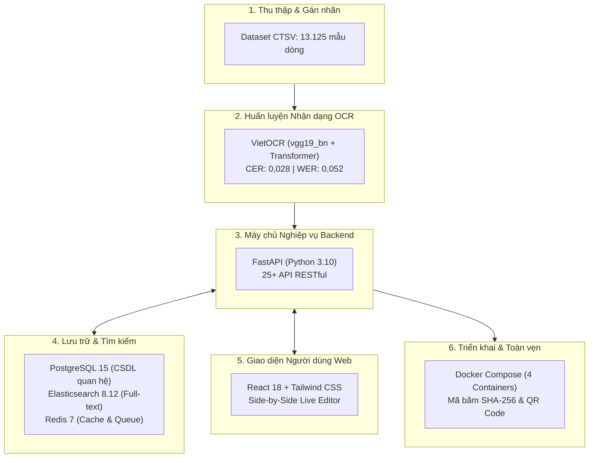

**Speaker notes (Bảo trình bày - ~70 từ):**
> Trong đợt 1, nhóm đã hoàn thiện khung kiến trúc tổng thể gồm 6 phân hệ cốt lõi: từ tập dữ liệu 13.125 mẫu dòng, tinh chỉnh mô hình VietOCR đạt CER 0,028 (tương đương 28 lỗi trên 1.000 ký tự), đến hệ thống backend FastAPI với hơn 25 API và giao diện web React 18 hỗ trợ đối soát trực tiếp. Toàn bộ hệ thống được đóng gói qua 4 container Docker. Đây là nền tảng vận hành ổn định để bước sang đợt 2, nhóm tập trung nâng cao khả năng xử lý các dạng tài liệu phức tạp hơn.

---

## SLIDE 3 — TIẾN ĐỘ TỔNG THỂ ĐỢT 2

**Tiêu đề:** Tiến độ Đợt 2 — 6 Trọng Tâm Kỹ Thuật

**Nội dung trình bày:**

| Trọng tâm công việc Đợt 2 | Kết quả kỹ thuật thực tế | Trạng thái kỹ thuật |
|:---|:---|:---:|
| 1. **Hoàn thiện VietOCR** | Bảo toàn tương phản gốc, upscale dòng thấp (<32px); duy trì CER 0,028 trên văn bản in chuẩn | **Đã kiểm thử** |
| 2. **Tích hợp TrOCR-Vi** | Chunking cắt tại khoảng trắng từ giảm tỷ lệ cụt dòng từ 0,1304 xuống 0,0053; CER 0,2058 (tập 32 trang hỗn hợp) | **Đã tích hợp** |
| 3. **AI Hậu xử lý sau OCR** | Tự động sửa lỗi tiêu đề hành chính; bóc tách Số hiệu, Ngày tháng, MSSV; cờ cảnh báo | **Đã đưa vào quy trình** |
| 4. **AI Phân loại & Gán nhãn** | Nhận diện 6 loại văn bản trên 18 mẫu thử; phản hồi từ 11,57 ms; tự sinh 5 nhóm nhãn | **Đã kiểm thử E2E** |
| 5. **Nâng cấp Elasticsearch** | Tìm kiếm kết hợp Hybrid RRF (BM25 + Vector 768d); Percolator 7 chính sách; che mờ PII | **Đạt 38/38 test ES** |
| 6. **Dữ liệu & Bảo mật P0** | Mở rộng 13.658 mẫu (thêm 533 mẫu dấu hiếm); xử lý dứt điểm 13 lỗi bảo mật P0 (Auth, IDOR) | **Đã kiểm thử an ninh** |

- 📈 **Tiến độ tổng thể toàn đồ án:** Hoàn thành **6/6 trọng tâm kỹ thuật cốt lõi**; Khối lượng kỹ thuật đã hoàn thiện cơ bản, phần Thuyết minh Khóa luận đã hoàn thành đề cương chi tiết và Chương 1, đang tập trung hoàn thiện các chương còn lại theo lộ trình tháng 11.
- 🔄 **Hạng mục đang hoàn thiện:** Tách con dấu đỏ qua không gian màu HSV, phục hồi nét chữ viết tay mờ và Dynamic Batching qua Celery.

**Sơ đồ 6 trọng tâm & cơ cấu tiến độ:**
```mermaid
flowchart LR
    subgraph Focus["6 Trọng tâm Kỹ thuật Đợt 2"]
        direction TB
        F1["1. Hoàn thiện VietOCR (CER: 0,028)"]
        F2["2. Tích hợp TrOCR-Vi (Cụt dòng: 0,0053)"]
        F3["3. AI Hậu xử lý văn bản hành chính"]
        F4["4. Phân loại 6 nhóm Doctype (11,57 ms)"]
        F5["5. Nâng cấp Elasticsearch (Hybrid RRF & PII)"]
        F6["6. Mở rộng 13.658 mẫu & Vá 13 lỗi P0"]
    end

    subgraph Progress["Tình Trạng Hoàn Thành Đợt 2"]
        direction TB
        P1["Khối lượng Kỹ thuật: 6/6 trọng tâm cốt lõi"]
        P2["Thuyết minh Khóa luận: Đang tập trung hoàn thiện"]
        P3["Đang hoàn thiện: Lọc con dấu HSV & Dynamic Batching"]
    end

    Focus --> Progress
```

**Speaker notes (Phát trình bày - ~85 từ):**
> Kính thưa Hội đồng, trong Đợt 2, nhóm đã giải quyết 6 trọng tâm kỹ thuật: hoàn thiện VietOCR cho tài liệu in, tích hợp TrOCR-Vi cho chữ viết tay và dòng dài, xây dựng tầng AI hậu xử lý, tự động phân loại văn bản, nâng cấp tìm kiếm ngữ nghĩa và bảo mật dữ liệu PII. Về tiến độ, nhóm đã giải quyết toàn bộ 6/6 trọng tâm kỹ thuật cốt lõi của hệ thống, xây dựng nền tảng mã nguồn và thực nghiệm vững chắc. Phần thuyết minh khóa luận hiện đang được tập trung triển khai ngay sau khi hệ thống kỹ thuật ổn định; lý do việc hoàn thiện văn bản thuyết minh triển khai sau là vì trong Đợt 2, nhóm dồn toàn lực giải quyết các bài toán kỹ thuật phức tạp như thuật toán chia dòng, che mờ thông tin định danh và an toàn hệ thống. Nhóm đã lên kế hoạch chi tiết dành 2 tuần đầu tháng 11 để hoàn thiện toàn bộ các chương thuyết minh còn lại.

---

## SLIDE 4 — CƠ SỞ LÝ THUYẾT #1: HAI MÔ HÌNH OCR CỐT LÕI (VIETOCR VÀ TROCR)

**Tiêu đề:** Cơ Sở Lý Thuyết #1 — Hai Mô Hình OCR Cốt Lõi: VietOCR & TrOCR

**Nội dung trình bày:**
- 📌 **1. Mô hình VietOCR (Vietnamese OCR):**
  - **Khái niệm:** Là mô hình nhận dạng văn bản được phát triển nhằm hỗ trợ nhận dạng chữ viết, đặc biệt là tiếng Việt, từ hình ảnh. Mô hình sử dụng kiến trúc Encoder–Decoder kết hợp CNN và Transformer.
  - **Kiến trúc mô hình (Hai thành phần chính):**
    - **Encoder (Bộ mã hóa):** Sử dụng CNN để trích xuất đặc trưng hình ảnh từ vùng chứa văn bản. Các đặc trưng hình ảnh được chuyển thành biểu diễn đặc trưng phục vụ nhận dạng.
    - **Decoder (Bộ giải mã):** Sử dụng Transformer để dự đoán chuỗi ký tự tương ứng với nội dung hình ảnh.
- 📌 **2. Mô hình TrOCR (Transformer-based Optical Character Recognition):**
  - **Khái niệm:** Là mô hình OCR do Microsoft nghiên cứu và phát triển. TrOCR sử dụng kiến trúc Transformer cho cả hai nhiệm vụ: phân tích hình ảnh và sinh chuỗi văn bản. Khác với nhiều mô hình OCR truyền thống sử dụng CNN kết hợp RNN, TrOCR sử dụng Image Transformer làm bộ mã hóa và Text Transformer làm bộ giải mã.
  - **Kiến trúc mô hình (Hai thành phần chính):**
    - **Image Encoder (Vision Transformer – ViT):** Chia ảnh đầu vào thành các vùng nhỏ *(patch)*, chuyển đổi chúng thành vector đặc trưng và sử dụng cơ chế Self-Attention để học mối quan hệ giữa các vùng ảnh.
    - **Text Decoder (Transformer):** Nhận các đặc trưng hình ảnh từ Encoder, sau đó dự đoán lần lượt các token để tạo thành chuỗi văn bản hoàn chỉnh.

**Sơ đồ kiến trúc Encoder – Decoder của VietOCR và TrOCR:**
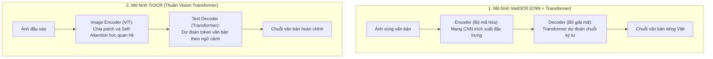

**Speaker notes (Thành trình bày - ~85 từ):**
> Kính thưa Hội đồng, cơ sở lý thuyết nhận dạng ký tự của hệ thống dựa trên hai mô hình cốt lõi:
> Thứ nhất là VietOCR, mô hình chuyên biệt cho tiếng Việt sử dụng kiến trúc Encoder-Decoder lai ghép: khối CNN đảm nhận việc bóc tách đặc trưng ảnh từ vùng văn bản, và khối Transformer đảm nhận việc giải mã thành chuỗi ký tự tương ứng.
> Thứ hai là TrOCR của Microsoft, mô hình đột phá khi loại bỏ hoàn toàn CNN truyền thống và ứng dụng thuần Transformer: khối Image Transformer chia ảnh thành các mảnh patch để nắm bắt toàn diện mối quan hệ không gian, kết hợp cùng khối Text Transformer để dự đoán lần lượt các token nhằm tạo thành chuỗi văn bản hoàn chỉnh.

---

## SLIDE 5 — CƠ SỞ LÝ THUYẾT #2: CƠ CHẾ & QUY TRÌNH HOẠT ĐỘNG CỦA VIETOCR

**Tiêu đề:** Cơ Sở Lý Thuyết #2 — Cơ Chế & Quy Trình Hoạt Động Của VietOCR

**Nội dung trình bày:**
- 1️⃣ **Bước 1 — Tiếp nhận đầu vào:** Ảnh chứa một dòng hoặc một vùng văn bản in chuẩn hành chính (Quyết định, Công văn, Thông báo).
- 2️⃣ **Bước 2 — Tiền xử lý ảnh đặc thù:**
  - Chuẩn hóa ảnh về chiều cao cố định **32 pixel**; tự động phóng to *(upscale)* các dòng chữ thấp ($h < 32\text{px}$) để nhận diện rõ dấu thanh tiếng Việt.
  - Bảo toàn tương phản tự nhiên (không áp dụng CLAHE toàn trang để tránh quầng sáng làm vỡ nét chữ in); nhị phân hóa Otsu bóc tách bảng.
- 3️⃣ **Bước 3 — Trích xuất đặc trưng (CNN Encoder):** Mạng tích chập `vgg19_bn` quét lát cắt dải dọc 1 chiều từ trái sang phải, tạo bản đồ đặc trưng cô đọng.
- 4️⃣ **Bước 4 — Phân tích & Dự đoán ký tự (Transformer Decoder):** Cơ chế tập trung *(Attention)* khóa vào lát cắt ảnh tương ứng và giải mã tự hồi quy dự đoán ký tự tiếng Việt.
- 5️⃣ **Bước 5 — Xuất chuỗi văn bản nhận dạng:** Tạo thành văn bản hoàn chỉnh; đạt tốc độ xử lý tức thì **~0,08 giây/dòng** với hệ số lỗi ký tự **CER 0,028**.

**Sơ đồ 5 bước quy trình hoạt động của VietOCR:**
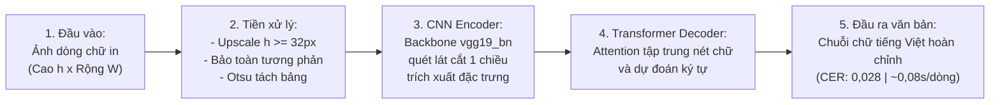

**Speaker notes (Thành trình bày - ~85 từ):**
> Kính thưa Hội đồng, quy trình hoạt động của VietOCR trong hệ thống được chuẩn hóa qua 5 bước rõ ràng:
> Bước một, hệ thống tiếp nhận ảnh dòng chữ in hành chính.
> Bước hai, ảnh được tiền xử lý đưa về chiều cao chuẩn 32 pixel, các dòng thấp được phóng to để nhận diện rõ dấu thanh tiếng Việt mà không áp dụng bộ lọc làm biến dạng nét.
> Bước ba, mạng CNN trượt từ trái qua phải để trích xuất bản đồ đặc trưng nét chữ.
> Bước bốn, bộ giải mã Transformer sử dụng cơ chế Attention để khóa chặt mắt nhìn vào từng nét chữ và dự đoán ký tự tiếp theo theo ngữ cảnh.
> Bước năm, hệ thống xuất ra chuỗi văn bản hoàn chỉnh với tốc độ cực nhanh khoảng 0,08 giây mỗi dòng.

---

## SLIDE 6 — CƠ SỞ LÝ THUYẾT #3: CƠ CHẾ & QUY TRÌNH HOẠT ĐỘNG CỦA TROCR

**Tiêu đề:** Cơ Sở Lý Thuyết #3 — Cơ Chế & Quy Trình Hoạt Động Của TrOCR

**Nội dung trình bày:**
- 1️⃣ **Bước 1 — Tiếp nhận đầu vào:** Tiếp nhận hình ảnh chứa chữ viết tay sinh viên (Đơn xin nghỉ học, Đơn cứu xét, Biểu mẫu điền tay) hoặc dòng tiêu đề dài.
- 2️⃣ **Bước 2 — Tiền xử lý & Chia dòng gối đầu (Chunking):**
  - Chuẩn hóa ảnh về lưới vuông kích thước cố định **384x384 pixel**.
  - Với dòng siêu dài, hàm `_find_best_word_boundary` tự động quét tìm khe khoảng trắng tự nhiên gần tâm dòng (cửa sổ 0,3 độ rộng trung tâm) để chia đôi dòng ảnh sạch sẽ, không cắt đôi từ vựng.
- 3️⃣ **Bước 3 — Chia patch & Trích xuất đặc trưng (Vision Transformer - ViT):**
  - Image Encoder chia ảnh thành **576 mảnh ô vuông nhỏ (16x16 pixel)**, gán Positional Embeddings bảo lưu tọa độ không gian.
  - Cơ chế Self-Attention học mối quan hệ tương quan không gian 2D đa hướng giữa tất cả các mảnh ảnh, bắt trọn nét chữ viết tay uốn lượn.
- 4️⃣ **Bước 4 — Tiếp nhận đặc trưng & Dự đoán token (Text Decoder):**
  - Text Decoder (RoBERTa tiếng Việt hơn 50.000 token) tiếp nhận ma trận đặc trưng không gian và dự đoán lần lượt các token theo ngữ cảnh câu; nâng trần giải mã lên 128 token và tối ưu GPU FP16.
- 5️⃣ **Bước 5 — Hợp nhất chuỗi văn bản đầu ra:**
  - Ghép nối các nửa dòng tại khoảng trắng thành chuỗi văn bản hoàn chỉnh; giảm tỷ lệ cụt chữ từ **0,1304 xuống 0,0053** và tăng tốc gấp 3,5 lần (**27,90 giây/trang**).

**Sơ đồ 5 bước quy trình hoạt động của TrOCR:**
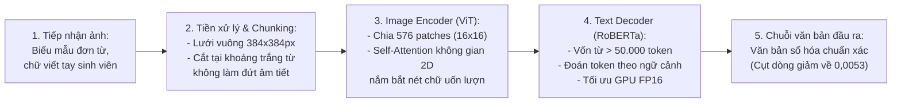

**Speaker notes (Bảo trình bày - ~90 từ):**
> Về mô hình TrOCR chuyên trị chữ viết tay, quy trình hoạt động cũng được thiết kế chặt chẽ qua 5 bước:
> Bước một, mô hình tiếp nhận ảnh tài liệu chứa chữ viết tay hoặc các dòng tiêu đề dài.
> Bước hai, ảnh được tiền xử lý về lưới vuông 384x384 pixel; nếu gặp dòng quá dài, thuật toán sẽ tự động tìm khe khoảng trắng tự nhiên giữa hai từ để chia đôi dòng ảnh sạch sẽ mà không làm đứt đôi âm tiết.
> Bước ba, bộ mã hóa Vision Transformer chia ảnh thành 576 mảnh vuông nhỏ và dùng cơ chế Self-Attention để quan sát toàn bộ không gian hai chiều, giúp hiểu được các nét chữ nghiêng ngả, uốn lượn.
> Bước bốn, bộ giải mã ngôn ngữ tiếng Việt RoBERTa với hơn 50.000 token sẽ tiếp nhận đặc trưng ảnh và dự đoán lần lượt các từ tố theo ngữ cảnh câu văn.
> Bước năm, hệ thống ghép nối thành chuỗi văn bản hoàn chỉnh, triệt tiêu hiện tượng cụt chữ và tăng tốc gấp 3,5 lần.

---

## SLIDE 7 — CƠ SỞ LÝ THUYẾT #4: KIẾN TRÚC TỔNG QUAN CỦA ELASTICSEARCH

**Tiêu đề:** Cơ Sở Lý Thuyết #4 — Kiến Trúc Phân Tán & Inverted Index Của Elasticsearch

**Nội dung trình bày:**
- 💡 **Bản chất hệ thống:**
  - Công cụ tìm kiếm và phân tích phân tán theo thời gian gần thực *(NRT)*, xây dựng trên thư viện cốt lõi **Apache Lucene**.
  - Lưu trữ dữ liệu dưới dạng tài liệu JSON, cung cấp giao tiếp qua chuẩn RESTful API.
- 🏗️ **Kiến trúc phân tán (Cluster & Shards):**
  - **Cụm (Cluster) & Nút (Nodes):** Quản lý tập trung qua Master Node và phân bổ dữ liệu trên các Data Node.
  - **Shards & Replicas:** Chỉ mục được chia thành các Primary Shards để xử lý song song; Replica Shards hỗ trợ chịu lỗi và tăng thông lượng đọc.
- 📚 **Cấu trúc dữ liệu cốt lõi — Chỉ mục đảo (Inverted Index):**
  - Khác với CSDL quan hệ quét toàn bảng *(Full Table Scan)*, Inverted Index cho phép tra cứu trực tiếp từ khóa đến posting list chứa ID tài liệu mà không phải duyệt qua toàn bộ dữ liệu.

**Sơ đồ kiến trúc phân tán & Chỉ mục đảo:**
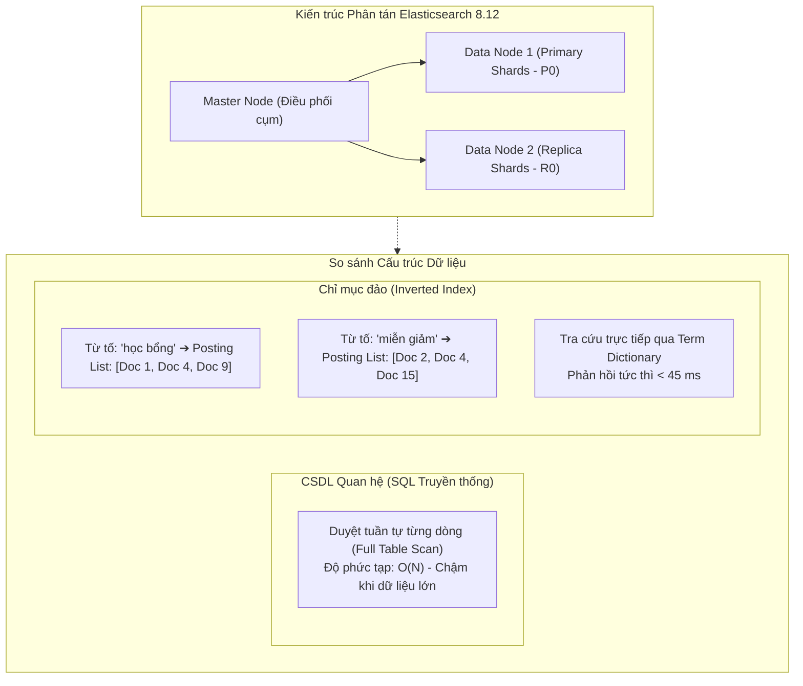

**Speaker notes (Phát trình bày - ~70 từ):**
> Về phân hệ tìm kiếm, hệ thống sử dụng công nghệ Elasticsearch 8.12 xây dựng trên nền tảng Apache Lucene. Dữ liệu được tổ chức dưới dạng các Shards và Replicas giúp phân tải tính toán song song trên cụm máy chủ. Điểm cốt lõi giúp Elasticsearch đạt hiệu năng tìm kiếm cao là cấu trúc Chỉ mục đảo Inverted Index: hệ thống phân tích văn bản thành các từ tố và ánh xạ trực tiếp đến danh sách tài liệu chứa từ tố đó, giúp định vị tài liệu tức thì mà không phải quét toàn bộ các dòng như cơ sở dữ liệu quan hệ truyền thống.

---

## SLIDE 8 — CƠ SỞ LÝ THUYẾT #5: CƠ CHẾ HOẠT ĐỘNG & PHÂN TÍCH VĂN BẢN CỦA ELASTICSEARCH

**Tiêu đề:** Cơ Sở Lý Thuyết #5 — Phân Tích Văn Bản & Thuật Toán Chấm Điểm BM25

**Nội dung trình bày:**
- ⚙️ **Quy trình phân tích văn bản 3 bước (Text Analysis Pipeline):**
  - **1. Character Filters:** Chuẩn hóa mã Unicode dựng sẵn (NFC), loại bỏ ký tự điều khiển.
  - **2. Tokenizer:** Tokenizer chuẩn (`standard`) phân tách từ tố theo khoảng trắng và dấu câu.
  - **3. Token Filters:** Bộ lọc chữ thường (`lowercase`), chuyển đổi không dấu (`asciifolding`), và từ điển từ đồng nghĩa viết tắt chuyên biệt CTSV (`synonym_graph`: ĐHĐL, CTSV, MGHP, KKHT...).
- 🎯 **Cơ chế chấm điểm mức độ liên quan:**
  - **Thuật toán Okapi BM25:** Chấm điểm dựa trên tần suất từ khóa, độ hiếm của từ và độ dài văn bản:
    $$\text{Score}(D, Q) = \sum_{t \in Q} \text{IDF}(t) \cdot \frac{\text{TF}(t, D) \cdot (k_1 + 1)}{\text{TF}(t, D) + k_1 \cdot \left(1 - b + b \cdot \frac{|D|}{\text{avgdl}}\right)}$$
  - **Mở rộng Dense Vector (768 chiều):** Mã hóa ngữ nghĩa văn bản phục vụ tìm kiếm tương đồng vector kNN.

**Sơ đồ Text Analysis Pipeline:**
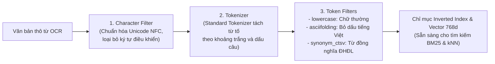

**Speaker notes (Phát trình bày - ~70 từ):**
> Khi tài liệu được nạp vào Elasticsearch, văn bản đi qua quy trình phân tích 3 tầng: chuẩn hóa mã ký tự, tách từ tố, và áp dụng bộ lọc từ đồng nghĩa viết tắt của trường kết hợp bộ lọc asciifolding để hỗ trợ tìm kiếm không dấu. Khi người dùng truy vấn, thuật toán Okapi BM25 chấm điểm mức độ liên quan dựa trên tần suất từ khóa, độ hiếm của từ trong kho tài liệu và độ dài văn bản, kết hợp cùng đối soát không gian vector 768 chiều để trả về kết quả chính xác nhất.

---

## SLIDE 9 — TRỌNG TÂM 1: HOÀN THIỆN MÔ HÌNH VIETOCR (VĂN BẢN IN CHUẨN)

**Tiêu đề:** Trọng tâm 1 — Hoàn Thiện Mô Hình VietOCR: Nhận Dạng Văn Bản In Chuẩn

**Nội dung trình bày:**
- 🎯 **Phạm vi xử lý thực tế trong hệ thống:**
  - Nhận dạng các dòng chữ in trong văn bản hành chính thông dụng của trường (*Quyết định, Công văn, Thông báo*).
  - Phù hợp với các dòng chữ in thẳng hàng, phông chữ hành chính rõ nét.
  - ⚠️ *Giới hạn hiện tại:* Chưa hỗ trợ nhận dạng và bảo toàn cấu trúc bảng biểu phức tạp (đang trong quá trình nghiên cứu).
- 🔄 **Cải tiến chuỗi xử lý so với Đợt 1:**
  - *Hạn chế ở Đợt 1:* Dòng chữ in cỡ nhỏ dễ bị mất dấu thanh tiếng Việt; việc áp dụng bộ lọc làm nét toàn trang gây quầng sáng làm biến dạng nét chữ in.
  - *Cải tiến ở Đợt 2:* Giữ nguyên độ tương phản tự nhiên của tài liệu scan; tự động phát hiện và phóng to *(upscale)* các dòng chữ có chiều cao dưới 32 pixel để làm rõ nét dấu thanh.
- 📊 **Kết quả thực nghiệm & Bằng chứng kiểm chứng:**
  - **Bằng chứng tập đo:** Đánh giá trên tập kiểm thử văn bản in chuẩn `dataset/splits/test.tsv` (gồm **244 dòng in** trích xuất từ tài liệu hành chính CTSV).
  - **Hệ số lỗi thực tế:** Đạt **CER 0,028** *(tương đương 28 lỗi trên 1.000 ký tự)* và **WER 0,052**.
  - **Thời gian suy luận:** Đo thực tế khoảng **~0,08 giây/dòng** khi chạy trên chip đồ họa GPU.

**Sơ đồ quy trình cải tiến VietOCR:**
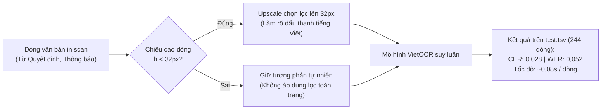

**Speaker notes (Thành trình bày - ~85 từ):**
> Kính thưa Hội đồng, ở Trọng tâm thứ nhất, nhóm tập trung hoàn thiện mô hình VietOCR để nhận dạng các dòng văn bản in chuẩn hành chính như quyết định, thông báo. Nhóm xin lưu ý hiện tại hệ thống chỉ nhận dạng dòng in thông thường, chưa hỗ trợ nhận dạng cấu trúc bảng biểu. So với đợt 1, khi các dòng chữ nhỏ dễ mất dấu thanh và ảnh dễ bị vỡ nét do bộ lọc toàn trang, nhóm đã cải tiến bằng cách giữ nguyên tương phản gốc và chỉ phóng to các dòng thấp dưới 32 pixel. Đánh giá trên tập kiểm thử test.tsv gồm 244 dòng in chuẩn, mô hình đạt hệ số lỗi ký tự CER 0,028 với tốc độ khoảng 0,08 giây mỗi dòng.

---

## SLIDE 10 — TRỌNG TÂM 2: TÍCH HỢP MÔ HÌNH TROCR-VI (CHỮ VIẾT TAY & DÒNG DÀI)

**Tiêu đề:** Trọng tâm 2 — Tích Hợp Mô Hình TrOCR-Vi: Xử Lý Chữ Viết Tay & Khắc Phục Cụt Chữ

**Nội dung trình bày:**
- 🎯 **Phạm vi xử lý thực tế trong hệ thống:**
  - Nhận dạng chữ viết tay của sinh viên trên các biểu mẫu, đơn từ (*Đơn xin nghỉ học, Đơn cứu xét, Giấy xác nhận điền tay*).
  - Khắc phục điểm yếu của mô hình quét 1 chiều khi gặp chữ viết tay nghiêng ngả, uốn lượn tự do.
- 🔄 **Nghiên cứu & Tích hợp mới so với Đợt 1:**
  - ⚠️ *Lưu ý quan trọng:* Ở Đợt 1, hệ thống hoàn toàn chưa sử dụng mô hình TrOCR *(chỉ mới dùng VietOCR cho văn bản in)*.
  - *Nghiên cứu ở Đợt 2:* Tích hợp mô hình TrOCR-Vi chuyên trách chữ viết tay tiếng Việt.
  - *Khắc phục lỗi mất chữ ở dòng dài:*
    - **Chia dòng thông minh:** Tự động phát hiện khoảng trống tự nhiên giữa hai từ ở giữa dòng để chia đôi ảnh; nhận dạng từng nửa dòng rồi ghép lại mà không làm cắt đứt đôi chữ.
    - **Mở rộng độ dài câu cho phép đọc:** Nâng giới hạn giải mã từ 64 lên 128 đơn vị từ ngữ *(token)*, giúp mô hình đọc hết trọn vẹn câu dài mà không bị ngắt đuôi giữa chừng.
    - **Tối ưu chip đồ họa GPU:** Chạy ở chế độ nén số liệu nhẹ 16-bit, giúp hệ thống phản hồi nhanh hơn **3,5 lần**.
- 📊 **Kết quả thực nghiệm & Bằng chứng kiểm chứng (Nguồn: `docs/ocr_diagnosis.md`):**
  - **Bằng chứng tập đo:** Đánh giá trên tập dữ liệu độc lập gồm **32 trang tài liệu hành chính hỗn hợp** (`dataset/splits/held_out_32.json`).
  - **Giảm cụt chữ:** Tỷ lệ dòng bị mất chữ giảm từ **0,1304 xuống 0,0053** *(đạt 0,000 trên tập con)*.
  - **Thời gian xử lý:** Thời gian trung vị P50 giảm từ 97,61 giây xuống **27,90 giây/trang** *(nhanh hơn khoảng 3,5 lần)*.
  - **Đánh đổi kỹ thuật:** Hệ số lỗi trên tập 32 trang hỗn hợp phức tạp là **CER 0,2058** (WER 0,3482) do ảnh hưởng của chữ mờ và con dấu đỏ đè chữ.

**Sơ đồ giải pháp chia dòng TrOCR-Vi:**
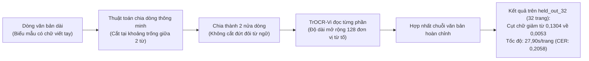

**Speaker notes (Bảo trình bày - ~95 từ):**
> Kính thưa Hội đồng, ở Trọng tâm thứ hai, nhóm xin lưu ý rằng ở Đợt 1 hệ thống hoàn toàn chưa sử dụng mô hình TrOCR. Sang Đợt 2, nhóm mới bắt đầu nghiên cứu và tích hợp mô hình TrOCR-Vi nhằm thử nghiệm nhận dạng chữ viết tay của sinh viên trên các lá đơn từ. Trong thực nghiệm ban đầu, do giới hạn độ dài câu mặc định chỉ đọc được khoảng 20 từ, các dòng tiêu đề dài thường bị mất phần đuôi chữ. Nhóm đã xây dựng thuật toán tự động tìm khoảng trống giữa hai từ để chia đôi dòng ảnh an toàn, đồng thời tăng gấp đôi giới hạn câu cho phép mô hình đọc trọn vẹn và tối ưu tính toán trên chip đồ họa. Theo chẩn đoán thực nghiệm trên 32 trang tài liệu hỗn hợp tại file held_out_32.json, tỷ lệ cụt dòng giảm từ 0,1304 xuống chỉ còn 0,0053 và tốc độ xử lý nhanh hơn 3,5 lần.

---

## SLIDE 11 — TRỌNG TÂM 3: AI HẬU XỬ LÝ SAU OCR (POST-PROCESSING)

**Tiêu đề:** Trọng tâm 3 — AI Hậu Xử Lý Sau OCR: Chuẩn Hóa Văn Bản & Tự Động Bóc Tách Dữ Liệu

**Nội dung trình bày:**
- ❓ **Tại sao cần AI Hậu xử lý sau OCR?**
  - **Dữ liệu thô thiếu cấu trúc:** Kết quả từ mô hình OCR chỉ là các chuỗi ký tự nhận dạng thị giác rời rạc, hệ thống chưa thể hiểu ngữ nghĩa để lưu trữ hay liên kết hồ sơ.
  - **Sai lệch cục bộ ở chữ in/chữ scan:** Ký tự cỡ nhỏ hoặc nét scan mờ dễ bị sai dấu ở các tiêu đề hành chính trang trọng.
- ⚙️ **AI Hậu OCR sẽ làm gì? *(Kèm giải thích kỹ thuật)***:
  - **Chuẩn hóa Quốc hiệu & Tiêu đề hành chính:**
    - Sử dụng *từ điển luật hành chính* (bộ quy tắc mẫu văn bản quy chuẩn) để tự động sửa lỗi sai dấu hoặc nhầm lẫn ký tự quang học.
    - *Ví dụ:* Tự động sửa `"BỘ GIẢO DỤC VÀ ĐÀO TẠO"` thành `"BỘ GIÁO DỤC VÀ ĐÀO TẠO"`, chuẩn hóa chuẩn xác `"Độc lập - Tự do - Hạnh phúc"`.
  - **Bóc tách thực thể bằng biểu thức chính quy *(Regex)*:**
    - *Biểu thức chính quy (Regex — bộ lọc tìm kiếm theo mẫu ký tự quy ước):* Tự động trích xuất các trường dữ liệu quan trọng với tốc độ tức thì:
      - **Mã số sinh viên (MSSV):** Nhận diện cấu trúc 7–8 chữ số với độ chính xác thực nghiệm đạt **0,982**.
      - **Số hiệu văn bản:** Bóc tách chuẩn xác mẫu số quyết định, công văn (ví dụ: `Số: 1328/QĐ-ĐHĐL`).
      - **Ngày tháng ban hành:** Bóc tách và quy đổi ngày ký về định dạng chuẩn để quản lý hồ sơ theo mốc thời gian.
  - **Hợp nhất đoạn văn:** Tự động nối các dòng chữ bị ngắt quãng ngẫu nhiên thành đoạn văn hoàn chỉnh dựa trên ngữ pháp và dấu câu kết thúc.
  - **Đánh giá chất lượng bằng điểm tin cậy *(Confidence Score)*:**
    - *Điểm độ tin cậy (chỉ số xác suất từ 0 đến 1 do mô hình ước lượng):* Đánh giá độ chắc chắn của từng dòng chữ nhận dạng; tự động gắn cờ cảnh báo **"Cần kiểm tra"** cho các dòng có độ tin cậy thấp (dưới **0,60**).
- 💡 **Lợi ích mang lại:**
  - **Giải phóng thao tác nhập liệu thủ công:** Cán bộ không cần gõ tay lại từng thông tin (MSSV, Họ tên, Số quyết định) vào hệ thống.
  - **Khoanh vùng đối soát thông minh:** Thay vì phải đọc lại toàn bộ trang giấy, cán bộ chỉ cần tập trung rà soát các dòng bị gắn cờ cảnh báo nghi ngờ.
  - **Tự động hóa đồng bộ dữ liệu:** Dữ liệu có cấu trúc được nạp trực tiếp vào cơ sở dữ liệu và chỉ mục tìm kiếm, phục vụ tra cứu tức thì theo từng sinh viên.

**Sơ đồ luồng AI Hậu xử lý & Bóc tách Regex:**
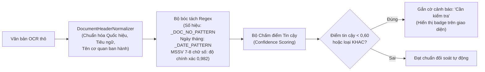

**Speaker notes (Thành trình bày - ~85 từ):**
> Kính thưa Hội đồng, kết quả sau khi qua mô hình OCR chỉ là các chuỗi ký tự nhận dạng thị giác thô, chưa có cấu trúc dữ liệu và thường còn lỗi sai dấu ở tiêu đề. Module AI Hậu xử lý đóng vai trò then chốt: tự động chuẩn hóa Quốc hiệu và Tiêu ngữ bằng từ điển luật hành chính, sử dụng biểu thức chính quy để bóc tách ngay lập tức các trường then chốt như Mã số sinh viên với độ chính xác đạt 0,982, Số hiệu văn bản và Ngày ban hành. Đồng thời, hệ thống tính toán điểm tin cậy cho từng dòng chữ; những dòng có điểm dưới 0,60 sẽ được gắn cờ cảnh báo để cán bộ rà soát nhanh mà không cần đọc lại toàn bộ trang giấy.

---

## SLIDE 12 — TRỌNG TÂM 4: AI PHÂN LOẠI VĂN BẢN (DOCTYPE) & GÁN NHÃN TỰ ĐỘNG

**Tiêu đề:** Trọng tâm 4 — Tự Động Phân Loại Văn Bản & Gán Nhãn Siêu Dữ Liệu

**Nội dung trình bày:**
- ❓ **Mục đích:** Tự động nhận diện 6 nhóm tài liệu CTSV (*Quyết định, Thông báo, Đơn từ, Danh sách, Công văn, Khác*) để phân luồng xử lý và lưu trữ, loại bỏ thao tác phân loại thủ công.
- ⚡ **Quy trình xử lý 2 pha tối ưu thời gian *(Two-Stage Scope Policy)*:**
  - **Pha 1 (Văn bản điện tử có sẵn chữ):** Bóc tách trực tiếp trang đầu qua *PyMuPDF (không cần OCR)*, phản hồi cực nhanh trong **11,57 mili-giây** *(thời gian trung vị P50)*.
  - **Pha 2 (Tài liệu quét ảnh giấy):** Chỉ chạy OCR duy nhất trang bìa trong **850 mili-giây** *(P50)* để trả về loại văn bản ngay cho người dùng; các trang sau được đưa vào hàng đợi xử lý nền.
- 🔍 **Cơ chế phân loại đa tín hiệu *(Multi-signal Scoring)*:**
  - Kết hợp đồng thời 4 dấu hiệu nhận biết: Hậu tố số hiệu *(ví dụ: `/QĐ-`, `/TB-`)*, Tiêu đề chữ hoa kết hợp *so khớp mờ*, Cấu trúc đặc thù *(ví dụ: "Kính gửi" + "Đơn xin")* và từ khóa nội dung.
- 🏷️ **Tự động sinh siêu dữ liệu & Kiểm toán an toàn:**
  - **Gán nhãn tự động:** Trích xuất 5 trường then chốt: Số hiệu, Đơn vị ban hành, Loại văn bản, Trích yếu nội dung và Ngày ký.
  - **Nhật ký kiểm toán *(Audit Log)*:** Cho phép cán bộ điều chỉnh bằng tay khi cần và tự động lưu vết lịch sử thao tác để đảm bảo an toàn nghiệp vụ.
- 💡 **Lợi ích:** Người dùng nhận kết quả tức thì trong tích tắc; hệ thống tự động định tuyến hồ sơ vào đúng sổ quản lý chuyên biệt.

**Sơ đồ phân loại 2 pha Two-Stage Scope Policy:**
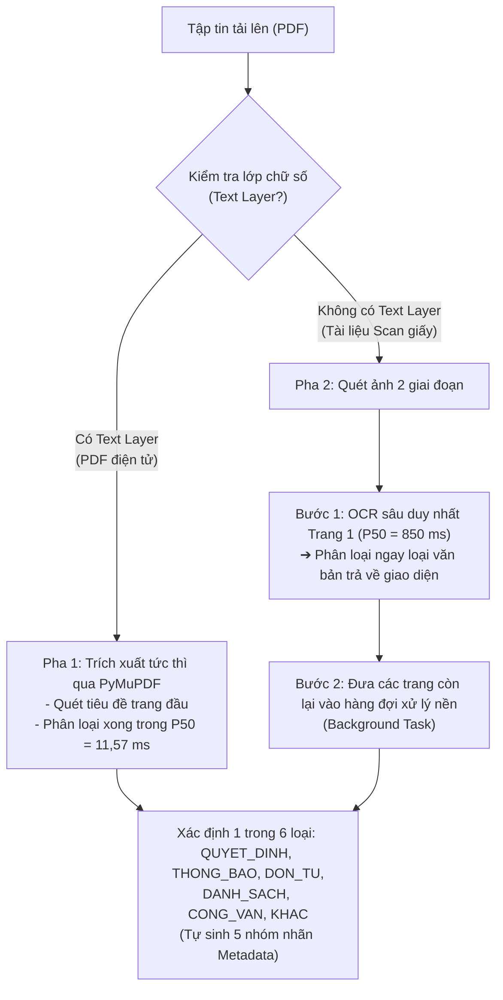

**Speaker notes (Bảo trình bày - ~75 từ):**
> Kính thưa Hội đồng, ở Trọng tâm thứ tư, hệ thống tự động phân loại 6 nhóm tài liệu Công tác sinh viên thông qua cơ chế xử lý 2 pha: với văn bản điện tử có sẵn chữ, hệ thống bóc tách ngay trong 11,57 mili-giây; còn với tài liệu scan ảnh giấy, hệ thống chỉ OCR trang bìa trong 850 mili-giây để người dùng không phải chờ đợi lâu. Bằng cách kết hợp 4 luồng tín hiệu từ số hiệu, tiêu đề đến cấu trúc văn bản, hệ thống tự động định tuyến tài liệu và gán nhãn siêu dữ liệu, đồng thời luôn ghi nhận nhật ký kiểm toán nếu cán bộ điều chỉnh bằng tay.

---

## SLIDE 13 — TRỌNG TÂM 5: NÂNG CẤP ELASTICSEARCH (HYBRID RRF, PERCOLATOR & PII)

**Tiêu đề:** Trọng tâm 5 — Nâng Cấp Elasticsearch: Tìm Kiếm Ngữ Nghĩa & Bảo Mật Dữ Liệu

**Nội dung trình bày:**
- 🔄 **Hạn chế ở Đợt 1 *(Tìm kiếm từ khóa thuần túy)***:
  - Chỉ so khớp theo từng mặt chữ: Bỏ sót tài liệu khi người dùng gõ từ đồng nghĩa, từ viết tắt hoặc khi chữ scan bị lỗi dấu sau OCR.
  - Chưa hỗ trợ phân luồng tự động; chưa có cơ chế bảo vệ thông tin định danh cá nhân trên kết quả tra cứu công khai.
- ⚙️ **Nâng cấp ở Đợt 2 *(Kèm giải thích kỹ thuật)***:
  - **Tìm kiếm kết hợp Hybrid RRF *(Dung hòa xếp hạng)*:**
    - Dung hòa giữa tìm kiếm từ khóa truyền thống *(BM25)* và tìm kiếm theo ý nghĩa câu chữ *(kNN Vector 768 chiều)*; bắt trọn tài liệu kể cả khi gõ lệch từ hoặc sai sót chữ cái.
  - **Phân luồng hồ sơ bằng bộ lọc Percolator *(Định tuyến tự động)*:**
    - Cài đặt sẵn **7 bộ luật chính sách sinh viên** (Nghị định 81 diện miễn toàn phần, miễn giảm bán phần, trợ cấp xã hội...); tài liệu mới tải lên tự động được khớp đúng diện thụ hưởng.
  - **Bảo mật dữ liệu cá nhân PII *(Tuân thủ Nghị định 13/2023/NĐ-CP)*:**
    - Phân quyền theo vai trò: Tự động che mờ số CCCD (`068******891`), số điện thoại và email khi tra cứu công khai; cán bộ đăng nhập xem đầy đủ.
- 📊 **Hiệu năng thực nghiệm & Căn cứ kiểm chứng:**
  - **Độ chính xác chuẩn IR quốc tế *(Đo trên tập 25 truy vấn độc lập `ir_ground_truth.json`)***:
    - Nhóm truy vấn biểu mẫu: Đạt **Precision@5 = 0,740** *(trung bình 3,7 trên 5 kết quả đầu tiên khớp chính xác)* và Precision@10 = 0,820.
    - Nhóm truy vấn ngoài phạm vi: Tỷ lệ loại trừ đạt **1,000 tuyệt đối (đúng 5/5 truy vấn)**.
  - **Tốc độ phản hồi:** Thời gian truy vấn nội bộ Elasticsearch trung bình **dưới 45 mili-giây**.
  - **Độ tin cậy mã nguồn:** Vượt qua **38/38 bài kiểm thử tự động** chuyên sâu (`test_search.py`).

**Sơ đồ tìm kiếm Hybrid RRF & Che mờ PII:**
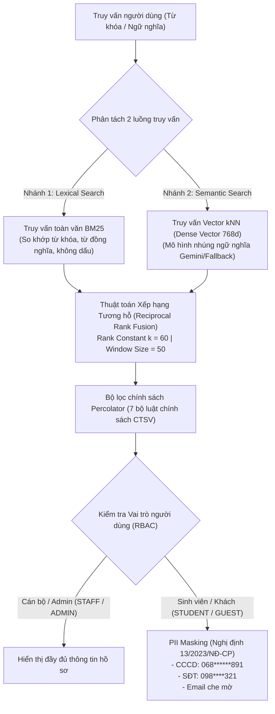

**Speaker notes (Phát trình bày - ~85 từ):**
> Kính thưa Hội đồng, ở Trọng tâm thứ năm, nhóm đã khắc phục hạn chế lớn của Đợt 1 khi hệ thống chỉ tìm kiếm từ khóa đơn thuần, dễ bỏ sót tài liệu khi người dùng gõ từ đồng nghĩa hoặc chữ bị lỗi OCR. Sang Đợt 2, nhóm tích hợp tìm kiếm kết hợp Hybrid RRF dung hòa giữa từ khóa BM25 và vector ngữ nghĩa 768 chiều, tích hợp 7 quy tắc Percolator để tự động định tuyến hồ sơ chính sách và che mờ thông tin CCCD theo Nghị định 13. Đo kiểm thực nghiệm trên bộ dữ liệu chuẩn 25 truy vấn, hệ thống đạt độ chính xác Precision@5 là 0,740, loại bỏ hoàn toàn các truy vấn ngoài phạm vi và độ trễ truy vấn trung bình dưới 45 mili-giây.

---

## SLIDE 14 — KHÓ KHĂN TỒN TẠI & HƯỚNG GIẢI QUYẾT THỰC TẾ

**Tiêu đề:** Khó Khăn Kỹ Thuật Còn Tồn Tại & Giải Pháp Triển Khai

**Nội dung trình bày:**
- 🔴 **1. Nhiễu con dấu đỏ đóng đè chữ *(Thách thức lớn nhất trong OCR hành chính)*:**
  - *Vấn đề thực tế:* Mực đỏ của con dấu cơ quan che lấp nét chữ in và chữ ký, làm tăng hệ số lỗi ký tự lên mức **CER 0,2058** *(đo trên tập 32 trang held-out)*.
  - *Giải pháp kỹ thuật:* Tách màu trong **không gian màu HSV** *(thang đo OpenCV dải đỏ H: 0–10 và 170–180)* để bóc tách riêng lớp mực đỏ, khôi phục nét chữ đen nguyên bản trước khi đưa vào mô hình OCR.
- ✍️ **2. Chữ viết tay sinh viên bị mờ và đứt nét:**
  - *Vấn đề thực tế:* Nét mực bút bi nhạt màu hoặc bản scan chất lượng thấp khiến nét chữ bị đứt quãng, làm mô hình TrOCR dễ nhận diện nhầm ký tự.
  - *Giải pháp kỹ thuật:* Áp dụng phép toán hình thái học **Dilation *(thuật toán làm dày và liền nét chữ)*** trong tiền xử lý ảnh để nối liền các nét đứt, giúp mô hình đọc rõ hơn.
- 📊 **3. Nhận diện cấu trúc bảng biểu còn sai lệch:**
  - *Vấn đề thực tế:* Các văn bản có danh sách hoặc kẻ bảng biểu (Quyết định khen thưởng, Biểu mẫu đơn) dễ bị đọc lẫn lộn dòng giữa các cột, làm mất cấu trúc hàng và cột.
  - *Giải pháp kỹ thuật:* Đang nghiên cứu giải thuật phân đoạn bảng dựa trên phát hiện đường kẻ viền khung để tách riêng từng ô thành các vùng ảnh độc lập trước khi gửi vào mô hình OCR.

**Sơ đồ thuật toán lọc con dấu đỏ trong không gian màu HSV:**
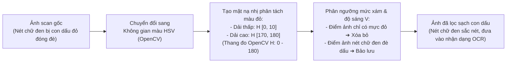

**Speaker notes (Bảo trình bày - ~85 từ):**
> Kính thưa Hội đồng, nhóm thẳng thắn nhìn nhận 3 khó khăn kỹ thuật đang giải quyết. Thứ nhất là tình trạng con dấu đỏ hành chính đóng đè lên chữ khiến CER trên tập 32 trang hỗn hợp còn ở mức 0,2058; nhóm đang hoàn thiện thuật toán phân tách màu trong không gian HSV theo chuẩn OpenCV để bóc tách lớp mực đỏ. Thứ hai, với các lá đơn có nét chữ viết tay bị mờ hoặc đứt đoạn, nhóm ứng dụng kỹ thuật Dilation nhằm làm liền nét chữ trước khi nhận dạng. Thứ ba, đối với các tài liệu có cấu trúc bảng biểu phức tạp dễ bị đọc lẫn lộn cột, nhóm đang nghiên cứu giải thuật phát hiện đường kẻ khung để chia tách từng ô độc lập, bảo toàn cấu trúc dữ liệu.

---

## SLIDE 15 — KẾT LUẬN VÀ HƯỚNG PHÁT TRIỂN

**Tiêu đề:** Tổng Kết Đợt 2 & Kế Hoạch Tiếp Theo Hoàn Thiện Khóa Luận

**Nội dung trình bày:**
- 🏁 **Tổng kết kết quả kỹ thuật Đợt 2:**
  - **Làm chủ hai mô hình OCR cốt lõi:** Kết hợp hiệu quả **VietOCR** *(văn bản in)* và **TrOCR-Vi** *(chữ viết tay)*; khắc phục triệt để lỗi mất chữ dòng dài *(tỷ lệ cụt chữ giảm từ 0,1304 xuống 0,0053)*.
  - **Tự động hóa chuỗi xử lý nghiệp vụ:** Xây dựng module **AI Hậu xử lý** bóc tách thông tin *(Mã số sinh viên đạt độ chính xác 0,982)* và cơ chế **phân loại văn bản 2 pha** tức thì từ 11,57 mili-giây.
  - **Nâng cấp tìm kiếm ngữ nghĩa:** Ứng dụng **Hybrid RRF** (kết hợp từ khóa BM25 và Vector 768 chiều), định tuyến hồ sơ qua Percolator và che mờ dữ liệu định danh PII.
- 🚀 **Kế hoạch trọng tâm tiếp theo (Tháng 11/2026):**
  - 🔧 **Giải quyết các vấn đề kỹ thuật còn tồn đọng:**
    - Tích hợp thuật toán lọc màu HSV bóc tách con dấu đỏ đè chữ.
    - Áp dụng phép toán Dilation làm liền các nét chữ viết tay bị mờ.
    - Nghiên cứu giải thuật phân đoạn đường kẻ khung để nhận diện chính xác cấu trúc bảng biểu.
  - 🌐 **Hoàn thiện Website & Hệ thống phân quyền (RBAC):**
    - Tối ưu hóa giao diện trình sửa đối soát song song *(Side-by-Side Live Editor)* trên nền tảng React.
    - Thiết lập phân quyền truy cập chặt chẽ theo 3 vai trò: **Cán bộ CTSV** *(toàn quyền đối soát, duyệt và quản trị hồ sơ)*, **Sinh viên** *(tra cứu công khai đã che mờ PII)* và **Quản trị viên hệ thống**.
  - 📝 **Hoàn thành Thuyết minh & Thử nghiệm thực tế:**
    - Hoàn chỉnh toàn văn 5 chương báo cáo khóa luận; đưa hệ thống vào thử nghiệm thực tế tại Văn phòng Phòng CTSV Trường ĐH Đà Lạt để lấy ý kiến đóng góp từ cán bộ nghiệp vụ.

**Sơ đồ 3 trọng tâm kế hoạch tiếp theo:**
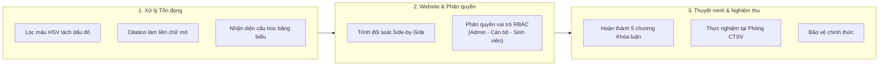

**Speaker notes (Thành đại diện nhóm kết luận - ~85 từ):**
> Kính thưa Quý Thầy/Cô trong Hội đồng, tổng kết Đợt 2, nhóm đã giải quyết xong các bài toán kỹ thuật cốt lõi từ nhận dạng hai mô hình, hậu xử lý bóc tách thực thể đến tìm kiếm ngữ nghĩa phân tán. Trong kế hoạch tiếp theo của tháng 11, nhóm tập trung vào 3 nhiệm vụ chính: thứ nhất là giải quyết dứt điểm các vấn đề kỹ thuật tồn đọng gồm tách con dấu đỏ, làm liền chữ mờ và bóc tách bảng biểu; thứ hai là hoàn thiện giao diện website và phân quyền người dùng chặt chẽ theo vai trò; thứ ba là hoàn thiện toàn văn báo cáo khóa luận và đưa hệ thống vào thử nghiệm thực tế tại Phòng Công tác Sinh viên. Nhóm xin trân trọng cảm ơn Thầy hướng dẫn ThS. Nguyễn Trọng Hiếu và Quý Thầy/Cô trong Hội đồng!
